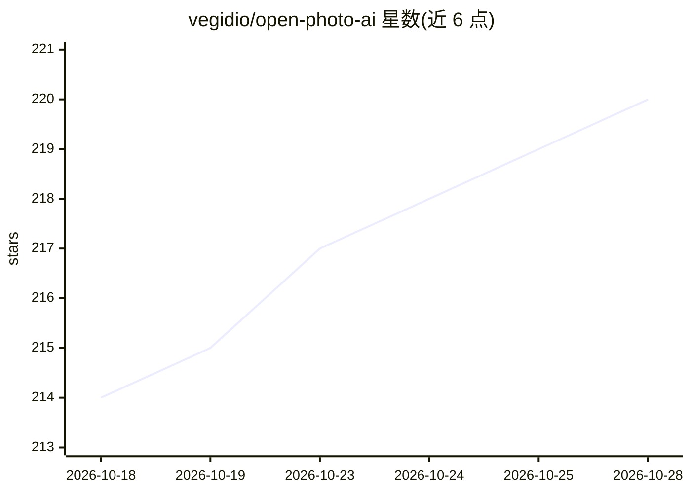

# vegidio/open-photo-ai

⭐ 220 · Rust · AGPL-3.0 · 推送 2026-10-24 · [GitHub](https://github.com/vegidio/open-photo-ai) · 个人维护

**桌面 AI 照片增强工具：降噪/修复/上色/放大等，Topaz 替代**

Rust 编写的开源照片 AI 增强应用，定位为 Topaz Photo AI 的开源替代。提供 GUI 与 CLI 两种使用方式，功能含降噪（Stockholm/Gothenburg/Malmö）、人脸恢复、上色、光线调整、色彩平衡、锐化与放大，模型均为改编自开源模型并发布于 Hugging Face。支持 Windows/macOS/Linux 桌面安装，无 GPU 时回退 CPU；macOS 仅 Apple Silicon。作者自述为个人业余项目，目标逐步对齐 Topaz 功能。

## 筛选速览

| 维度 | 判定 | 备注 |
|---|---|---|
| AI 角色 | `ai-native` | 本体是模型或模型工具 |
| 许可风险 | `viral` | AGPL-3.0 |
| 部署形态 | `None` |  |
| 模型依赖 | — | README 未给出锁定关系 |
| 硬件要求 | — | 无带数字的原话,不猜 |
| 安装摩擦 | `medium` | 含编译或系统依赖之一 |
| 成熟度 | `idea` | |

## 能力要点

- 7 类增强（降噪/人脸恢复/上色/光线/色彩/锐化/放大），每类多个可选模型
- GUI 与 CLI 双形态，GUI 支持 Autopilot 自动分析建议增强
- CUDA/TensorRT 加速（计算能力 7.5+），无 GPU 回退 CPU
- 跨平台安装脚本自动检测系统架构安装

## 适用场景

- 批量修复低光/高 ISO 照片的噪点
- 给黑白老照片上色并修复人像
- 放大低分辨率照片用于打印或展示

## 场景标签

`图像视频处理` · 领域:感知与多模态

## 证据(README 行号)

> L5:  Open Photo AI is an open source alternative to the popular photo AI editor.
> L15: That is why I created this project: an open-source alternative to Topaz Photo AI. It may never match the same level
> L110: All enhancements available here come from open-source AI models that were adapted and converted to work on this pr

## 星数曲线

2026-10-18 214 → 2026-10-28 220（+6）

---
*卡片 v1 · prompt 1.4 · 生成 2026-10-22 · 置信度 high · 依据 README sha `63f9b988b3a1` · [字段定义](../../DATASET.md)*
