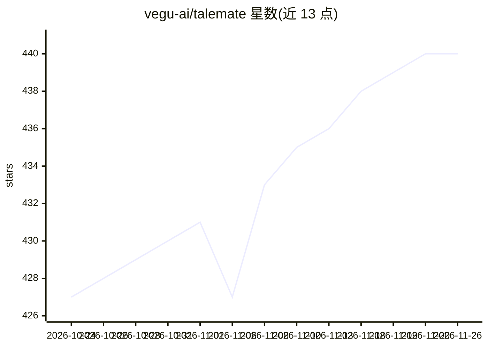

# vegu-ai/talemate

⭐ 440 · Python · AGPL-3.0 · 推送 2026-11-21 · [GitHub](https://github.com/vegu-ai/talemate) · 个人维护

**面向玩家的 AI 角色扮演应用，跟踪世界与游戏状态**

Talemate 是一个 AI 角色扮演客户端，以叙述、一致的世界与游戏状态跟踪为重点。核心机制包括：为对话、叙述、总结、场景指导、世界状态跟踪等分配独立 agent，每个 agent 可配置不同客户端与模型；维护长期记忆、分层历史摘要与时间流逝跟踪；角色仅知晓其经历过的内容，并提供 Learn/Never Learn 规则。还提供图像生成、带多后端的语音合成、Jinja2 提示词模板覆盖、节点编辑器与场景版本回溯。安装说明在文档站点提供，README 未含具体命令。

## 筛选速览

| 维度 | 判定 | 备注 |
|---|---|---|
| AI 角色 | `ai-native` | 本体是模型或模型工具 |
| 许可风险 | `viral` | AGPL-3.0 |
| 部署形态 | `None` |  |
| 模型依赖 | local-ok | 支持本地模型 |
| 硬件要求 | — | 无带数字的原话,不猜 |
| 安装摩擦 | `low` | 无编译、无系统依赖或容器化 |
| 成熟度 | — | 结构信号不足 |

## 能力要点

- 多 agent 架构：对话、叙述、世界状态跟踪等各有独立模型配置
- 长期记忆与分层历史摘要，角色仅知其经历片段
- 图像生成、语音合成与节点编辑器等内置功能
- 支持多种云端与自托管模型 API 及 OpenAI 兼容接口

## 适用场景

- 与 AI 进行长篇角色扮演并保持世界观一致
- 跟踪角色与世界的状态变量以维持剧情连贯
- 为角色生成肖像和场景插图、配置角色语音

## 场景标签

`图像生成` `语音合成` · 领域:内容生成

## 证据(README 行号)

> L3: Roleplay with AI, with a focus on narration and consistent world and game state tracking.
> L11: - Agents for dialogue, narration, summarization, scene direction, editing, world state tracking, character and scen

## 星数曲线

2026-10-24 427 → 2026-11-26 440（+13）

---
*卡片 v1 · prompt 1.4 · 生成 2026-11-25 · 置信度 high · 依据 README sha `e97adf200130` · [字段定义](../../DATASET.md)*
