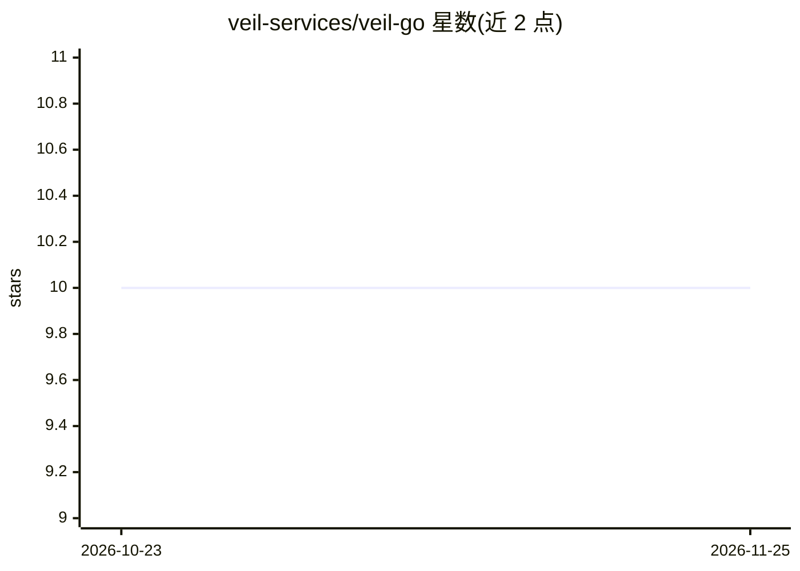

# veil-services/veil-go

⭐ 10 · Go · MIT · 推送 2025-12-05 · [GitHub](https://github.com/veil-services/veil-go) · [官网](https://veil.services) · 组织维护

**Go 库：在提示词发送给 LLM 前本地检测并掩码 PII**

面向 Go 开发者的 PII 防泄漏库：本地检测邮件、信用卡、CPF/CNPJ、电话、IP、UUID 等敏感数据，以确定性占位符（如 <<EMAIL_1>>）掩码后再调用 LLM，并在响应中还原，以保留上下文引用。另提供 Sanitize 单向掩码辅助函数用于日志脱敏，导出类型化错误。README 声称面向高吞吐环境设计，线程安全，含基准测试与回归目标。MIT 许可，通过 go get 安装。

## 筛选速览

| 维度 | 判定 | 备注 |
|---|---|---|
| AI 角色 | `ai-ecosystem` | LLM/agent 周边工具 |
| 许可风险 | `permissive` | MIT |
| 部署形态 | `None` |  |
| 模型依赖 | — | README 未给出锁定关系 |
| 硬件要求 | — | 无带数字的原话,不猜 |
| 安装摩擦 | `low` | 无编译、无系统依赖或容器化 |
| 成熟度 | — | 结构信号不足 |

## 能力要点

- 本地检测并确定性掩码 7 类 PII（Email/信用卡/IPv4/电话/UUID/CPF/CNPJ）
- 掩码-调用-还原工作流，占位符在会话内一致以保留 LLM 上下文
- Sanitize 辅助函数用于日志单向脱敏
- 提供基准测试命令与检测器微基准回归目标

## 适用场景

- 把客户数据发给 OpenAI/Anthropic 前先掩码敏感字段
- 防止 PII 泄漏到日志与向量数据库
- API 网关、流处理等高吞吐链路中嵌入脱敏层

## 场景标签

`网络安全` · 领域:学习与行业

## 证据(README 行号)

> L12: **Veil** is a high-performance, developer-first library that prevents PII (Personally Identifiable Information) fro
> L22: - **✅ The Veil Way:** A simple wrapper that masks data *before* the call and restores it *after*, preserving the LL
> L36: go get github.com/veil-services/veil-go

## 星数曲线

2026-10-23 10 → 2026-11-25 10（+0）

---
*卡片 v1 · prompt 1.4 · 生成 2026-11-19 · 置信度 high · 依据 README sha `267b854d20db` · [字段定义](../../DATASET.md)*
