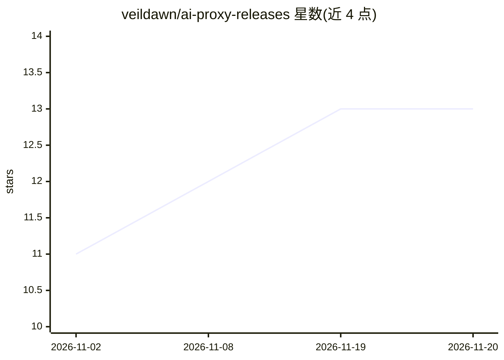

# veildawn/ai-proxy-releases

⭐ 13 · Ruby · NOASSERTION · 推送 2026-11-16 · [GitHub](https://github.com/veildawn/ai-proxy-releases) · [官网](https://github.com/veildawn/ai-proxy-releases/releases/latest) · 个人维护 · 中文 README

**自托管 AI 网关：把多上游账号汇成团队共享端点**

单二进制、单端口的自托管 API 网关：将 Claude、Codex、xAI、Kiro、Kimi、Cursor 等订阅账号或 API key 汇入账号池，对外提供统一端点，支持流式、工具调用、图像与 reasoning 的协议转换。内置账号轮换与故障转移、并发限制、每账号出站代理、用户/API key/配额/预算计费与用量面板，附中英文管理界面。提供一键安装脚本、Homebrew、Docker Compose 与手动二进制四种安装方式，需外部 PostgreSQL（Compose 自带）。

## 筛选速览

| 维度 | 判定 | 备注 |
|---|---|---|
| AI 角色 | `ai-ecosystem` | LLM/agent 周边工具 |
| 许可风险 | `none` | NOASSERTION |
| 部署形态 | `self-host` | docker 或自建部署 |
| 模型依赖 | locked-api |  |
| 硬件要求 | — | 无带数字的原话,不猜 |
| 安装摩擦 | `low` | 无编译、无系统依赖或容器化 |
| 成熟度 | — | 结构信号不足 |

## 能力要点

- 多上游账号池：轮换、故障转移、按账号限并发、独立出站代理
- 统一端点透传流式、工具调用、图像与 thinking/reasoning，不支持项显式报错
- 用户、API key、配额与月度预算管理，内置模型价格表
- 一键脚本/Homebrew/Docker Compose/二进制四种安装，升级自动迁移数据库

## 适用场景

- 团队共享一批 AI 订阅账号，统一端点接入并追踪用量与成本
- 管理多账号池，避免单个账号失效导致服务中断
- 在管理面板查看谁用了什么、花了多少、哪个账号不可用

## 场景标签

`模型网关` · 领域:Agent 开发

## 证据(README 行号)

> L5: Got Claude, Codex, Kiro, Kimi, Cursor, or xAI subscriptions (or API keys) and want the whole team on them? Drop the 
> L14: - Streaming, tool calls, images, and thinking/reasoning come through. If something can't be translated, you get an 

## 星数曲线

2026-11-02 11 → 2026-11-20 13（+2）

---
*卡片 v1 · prompt 1.4 · 生成 2026-11-18 · 置信度 high · 依据 README sha `829a33061310` · [字段定义](../../DATASET.md)*
