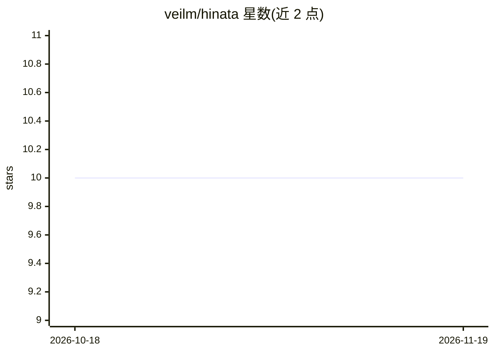

# veilm/hinata

⭐ 10 · Go · MIT · 推送 2026-08-29 · [GitHub](https://github.com/veilm/hinata) · 个人维护

**Unix 风格组合式 LLM 命令行工具集**

以 Unix 工具风格与 LLM 交互的命令行工具集：hnt-llm 接收管道输入的 prompt 并将模型响应流式输出到 stdout；hnt-chat 将会话抽象为纯文本文件管理；hnt-web 提供 hnt-chat 的 Web 界面，可在浏览器中打开同一批会话。各工具遵循管道组合方式，可直接嵌入脚本。另附 browse 浏览器自动化、llm-pack 源码打包、shell-exec、tui-select 等辅助工具。需 Git 与 Go 环境，支持 Linux/macOS，经 curl 安装脚本安装。

## 筛选速览

| 维度 | 判定 | 备注 |
|---|---|---|
| AI 角色 | `ai-ecosystem` | LLM/agent 周边工具 |
| 许可风险 | `permissive` | MIT |
| 部署形态 | `None` |  |
| 模型依赖 | — | README 未给出锁定关系 |
| 硬件要求 | — | 无带数字的原话,不猜 |
| 安装摩擦 | `low` | 无编译、无系统依赖或容器化 |
| 成熟度 | — | 结构信号不足 |

## 能力要点

- hnt-llm 纯 LLM 输入输出流式接口，可嵌入脚本管道
- 会话以纯文本文件形式管理（hnt-chat）
- hnt-web 提供 Web 界面访问同一批命令行会话
- 附带浏览器自动化、源码打包等辅助工具

## 适用场景

- 在 shell 脚本中直接调用 LLM 并流式读取输出
- 在命令行管理基于文件的对话会话
- 在浏览器中查看与命令行相同的会话记录

## 场景标签

 · 领域:LLM 基础设施/开发者工具

## 证据(README 行号)

> L1: simple Unix-style interfaces for interacting with LLMs
> L15: - `hnt-llm` sends a prompt to an LLM and streams the response to stdout (pure LLM i/o)
> L16: - `hnt-chat` manages conversations as an abstracted layer, as plaintext files

## 星数曲线

2026-10-18 10 → 2026-11-19 10（+0）

---
*卡片 v1 · prompt 1.4 · 生成 2026-11-19 · 置信度 mid · 依据 README sha `7478f3f69b47` · [字段定义](../../DATASET.md)*
