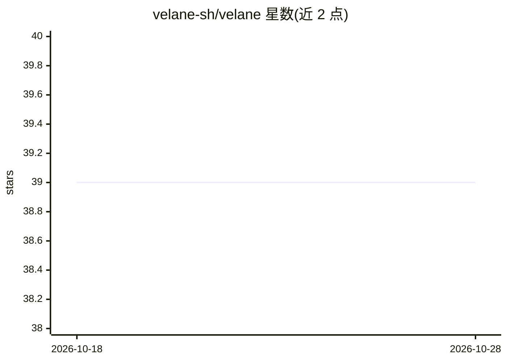

# velane-sh/velane

⭐ 39 · Go · NOASSERTION · 推送 2026-08-27 · [GitHub](https://github.com/velane-sh/velane) · [官网](https://velane.sh) · 个人维护

**面向 agent 与小型应用的云部署平台：沙箱执行+800+集成**

自托管的 agentic 云基础设施：通过 git push-to-deploy 部署 agent、API 与小型软件，提供 dev/staging/prod 三环境、版本回滚、金丝雀分流、AES-256-GCM 加密的 secrets 管理、每次调用的日志指标与重放。代码以 TypeScript/Bun 或 Python 片段形式发布，运行于零冷启动安全沙箱，可选 Firecracker VM 隔离（需 KVM）。内置 800+ OAuth 集成，令牌自动注入；提供 MCP server、CLI 与可嵌入仪表盘。开发者需自行 clone 仓库并以 docker compose 启动。

## 筛选速览

| 维度 | 判定 | 备注 |
|---|---|---|
| AI 角色 | `ai-ecosystem` | LLM/agent 周边工具 |
| 许可风险 | `none` | NOASSERTION |
| 部署形态 | `self-host` | docker 或自建部署 |
| 模型依赖 | — | README 未给出锁定关系 |
| 硬件要求 | — | 无带数字的原话,不猜 |
| 安装摩擦 | `low` | 无编译、无系统依赖或容器化 |
| 成熟度 | — | 结构信号不足 |

## 能力要点

- git push-to-deploy 与 dev/staging/prod 三环境、即时回滚、金丝雀分流
- 800+ OAuth 集成，令牌自动注入，代码不接触凭据
- 沙箱化 Bun/Python 执行，可选 Firecracker VM 隔离与出站策略管控
- MCP server 接入 Cursor/Claude Code，AI 助手可在编辑器内创建、发布、调用 snippet

## 适用场景

- 自托管部署 agent、API 与小型工作流并管理多环境
- 让 AI 编码助手通过 MCP 直接构建和发布服务
- 为 agent 集成 SaaS 凭据而不在代码中暴露 secrets

## 场景标签

`工作流自动化` · 领域:效率与自动化

## 证据(README 行号)

> L4:  Deploy agents, APIs, and small software with version control, dev, staging, and production environments, secrets ma
> L59: - **MCP server:** connect Cursor or Claude Code directly to generate and deploy snippets

## 星数曲线

2026-10-18 39 → 2026-10-28 39（+0）

---
*卡片 v1 · prompt 1.4 · 生成 2026-10-25 · 置信度 high · 依据 README sha `9326e77d0400` · [字段定义](../../DATASET.md)*
