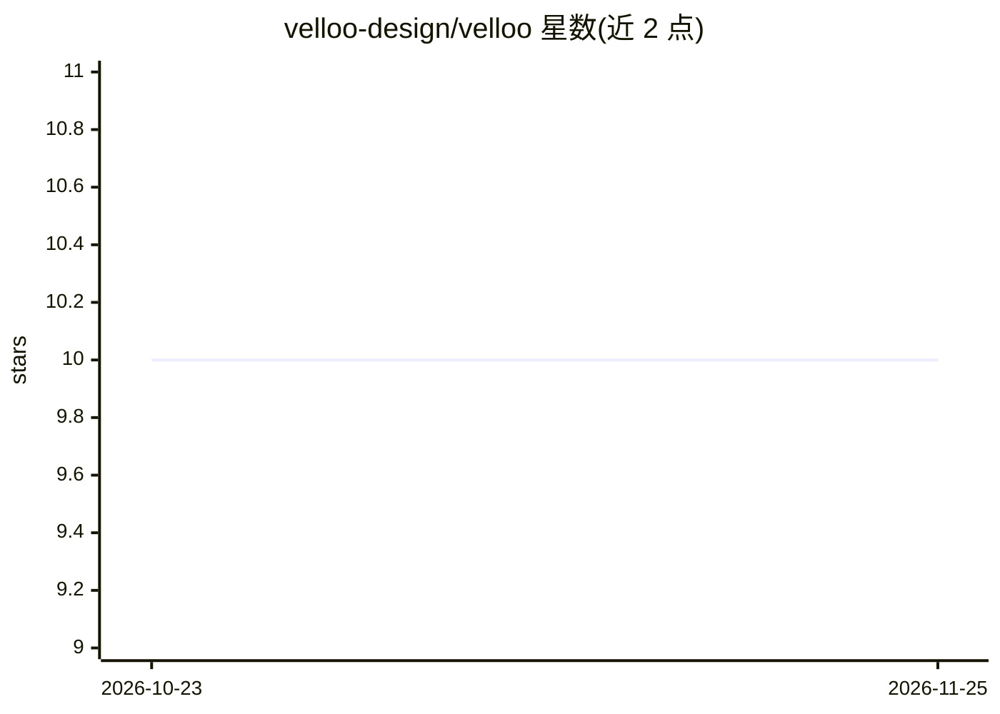

# velloo-design/velloo

⭐ 10 · TypeScript · Apache-2.0 · 推送 2026-11-17 · [GitHub](https://github.com/velloo-design/velloo) · [官网](https://velloo.design) · 个人维护

**给 AI 编码 agent 用的本地优先设计画布，可回写代码**

Velloo 是一个本地运行的开源设计画布，定位在应用旁边：setup 页面读取应用的组件、主题与路由，编码 agent 从真实组件出发在画布上绘制多个设计方向，用户评论与调整后，agent 将选中的设计以应用自身的框架写回代码，并与运行中的应用比对。屏幕以可读组件树保存在用户自有文件夹。Agent tab 运行 Claude Code、Codex 或任何支持 Agent Client Protocol 的 agent，画布外的 agent 可经 MCP 接入；画布无需账号、不发遥测，Velloo Cloud 为可选的分享链接服务。

## 筛选速览

| 维度 | 判定 | 备注 |
|---|---|---|
| AI 角色 | `ai-ecosystem` | LLM/agent 周边工具 |
| 许可风险 | `permissive` | Apache-2.0 |
| 部署形态 | `library` | 以包/库形式分发 |
| 模型依赖 | locked-api |  |
| 硬件要求 | — | 无带数字的原话,不猜 |
| 安装摩擦 | `low` | 无编译、无系统依赖或容器化 |
| 成熟度 | `idea` | |

## 能力要点

- 画布上的设计由 agent 从用户真实组件生成，选中的方向可写回应用代码
- Agent tab 支持 Claude Code、Codex 及 Agent Client Protocol 协议 agent，画布外经 MCP 接入
- 本地优先：无需账号、无遥测，屏幕以组件树保存在自有文件夹
- 支持 shadcn/ui+Tailwind、Material UI、Ant Design、Chakra、htmx 等栈

## 适用场景

- 在改应用代码前，先在画布上并排探索一个页面的多个设计方向
- 把不在这个仓库里的人请到分享链接上对设计做评论，评论回流给 agent
- 从浏览器里的一个真实页面出发（velloo capture）开始重设计

## 场景标签

`编码 Agent` · 领域:编码与开发

## 证据(README 行号)

> L51: - **Which agents.** The Agent tab runs Claude Code, Codex, or any installed
> L108: Agents outside the canvas connect over MCP: Claude Code, Codex, Cursor, GitHub

## 星数曲线

2026-10-23 10 → 2026-11-25 10（+0）

---
*卡片 v1 · prompt 1.4 · 生成 2026-11-19 · 置信度 high · 依据 README sha `f226f83f6b8a` · [字段定义](../../DATASET.md)*
