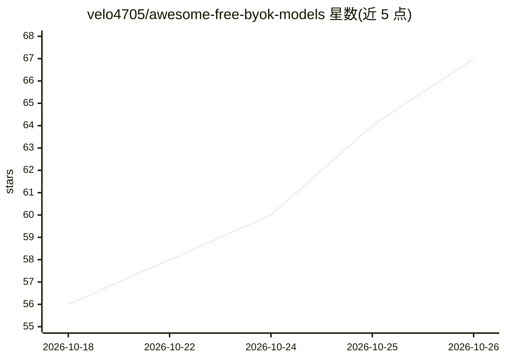

# velo4705/awesome-free-byok-models

⭐ 67 · Python · CC0-1.0 · 推送 2026-10-25 · [GitHub](https://github.com/velo4705/awesome-free-byok-models) · 个人维护

**免信用卡 LLM 免费 API 层的策展清单：39 家供应商与模型额度**

策展型 awesome 清单，收录当前仍可自助续额、注册无需信用卡的文本生成 LLM API 供应商（共 39 家 Replenishable 供应商），按配额、上下文长度、延迟列表化；每个供应商给出 Base URL、免费额度、经验证的模型清单与验证日期。数据来源为供应商文档及 scripts/verify.py 的实时 API 验证。排除试用后收费、需政府 ID 或中国大陆需居住验证的网关等服务，设有移除政策。面向开发者将免费 Key 接入编码工具与自定义项目（BYOK 方式）。

## 筛选速览

| 维度 | 判定 | 备注 |
|---|---|---|
| AI 角色 | `ai-knowledge` | 知识聚合/清单类 |
| 许可风险 | `viral` | CC0-1.0 |
| 部署形态 | `None` |  |
| 模型依赖 | — | README 未给出锁定关系 |
| 硬件要求 | — | 无带数字的原话,不猜 |
| 安装摩擦 | `low` | 无编译、无系统依赖或容器化 |
| 成熟度 | — | 结构信号不足 |

## 能力要点

- 收录 39 家可自动续额的免费 API 供应商
- 每家列出 Base URL、免费额度、模型上下文与延迟实测
- 配额数据来自 provider 文档与 scripts/verify.py 实时验证
- 明确收收录范围与移除政策（免费层失效即移除）

## 适用场景

- 为编码助手或聊天工具找不用绑卡的免费 LLM API
- 对比各家免费额度、上下文长度与延迟做选型
- 免费层命中限流时从清单切换备用供应商

## 场景标签

`精选清单` · 领域:学习与行业

## 证据(README 行号)

> L9: Text‑generation LLM API models that are currently available as free and self‑replenishing from their API providers, 
> L23: **Data sources:** Quota, context size, and latency figures are drawn from provider documentation and live API verif

## 星数曲线

2026-10-18 56 → 2026-10-26 67（+11）

---
*卡片 v1 · prompt 1.4 · 生成 2026-10-24 · 置信度 high · 依据 README sha `17500157027b` · [字段定义](../../DATASET.md)*
