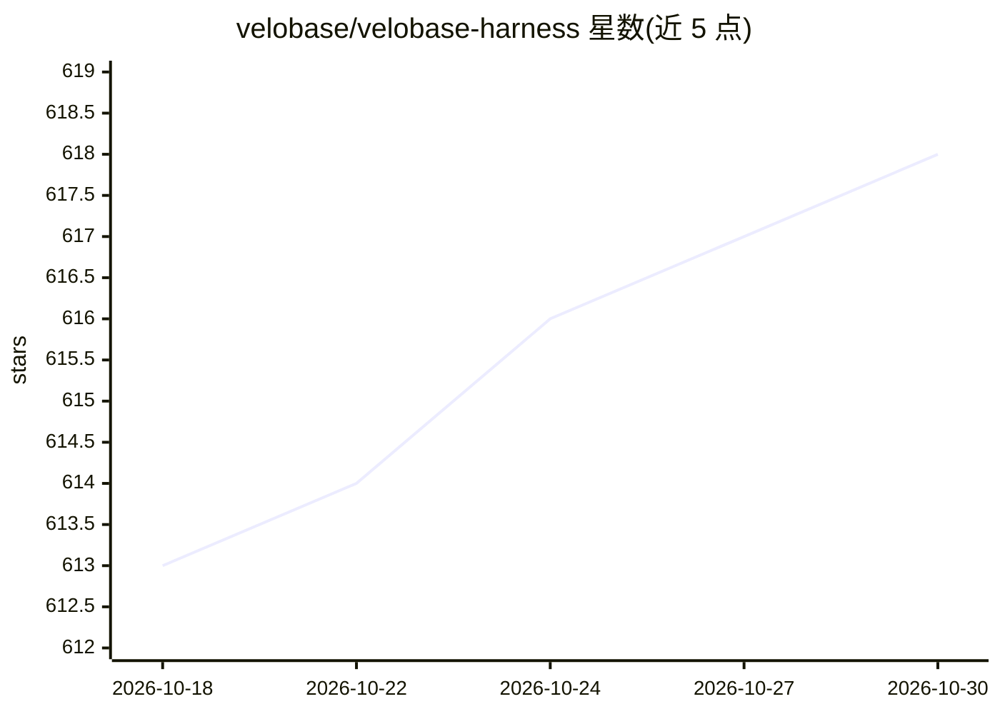

# velobase/velobase-harness

⭐ 618 · TypeScript · MIT · 推送 2026-10-26 · [GitHub](https://github.com/velobase/velobase-harness) · 组织维护 · 中文 README

**把 AI 原型变成付费 SaaS 的开源 Next.js 样板框架**

面向 AI 独立开发者与团队的 MIT 许可 Next.js SaaS 样板与应用框架：内置用户账户、订阅与用量计费、积分账本、支付集成（Stripe/NowPayments 文档）、多模型 AI 聊天、后台 Worker（BullMQ）、归因与联盟分销、反滥用控制、管理工具及 Docker/Kubernetes 部署指引。本地一键启动依赖 Node.js、pnpm 与 Docker（仅跑 PostgreSQL/Redis），产品特定的 AI 工作流仍需自行实现。

## 筛选速览

| 维度 | 判定 | 备注 |
|---|---|---|
| AI 角色 | `ai-ecosystem` | LLM/agent 周边工具 |
| 许可风险 | `permissive` | MIT |
| 部署形态 | `self-host` | docker 或自建部署 |
| 模型依赖 | — | README 未给出锁定关系 |
| 硬件要求 | — | 无带数字的原话,不猜 |
| 安装摩擦 | `low` | 无编译、无系统依赖或容器化 |
| 成熟度 | — | 结构信号不足 |

## 能力要点

- 内置订阅/用量计费、积分账本与支付集成模式
- 多模型 AI 聊天与 BullMQ 后台 Worker
- 归因、联盟分销（双重记账账本/退款回收）与反滥用控制（限流/Turnstile/一次性邮箱检查）
- 同一代码库可按 Web/API/Worker 拆分服务运行

## 适用场景

- 把 AI demo 快速补上计费、账户与生产基础设施
- 给已上线的 AI 产品加用量计费、归因与反滥用
- 让 AI 编程代理基于文档化的生产框架做开发

## 场景标签

 · 领域:SaaS 基础设施/开发框架

## 证据(README 行号)

> L59: Velobase Harness is an open-source AI SaaS boilerplate and application framework
> L60: for developers who want to turn an AI prototype into a paid product. It combines

## 星数曲线

2026-10-18 613 → 2026-10-30 618（+5）

---
*卡片 v1 · prompt 1.4 · 生成 2026-10-21 · 置信度 mid · 依据 README sha `07ef5cc7bd5a` · [字段定义](../../DATASET.md)*
