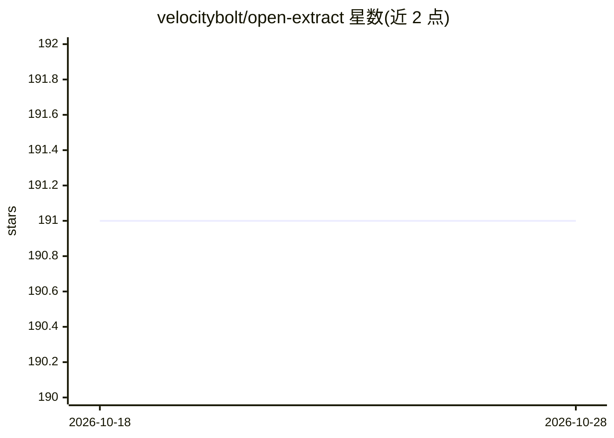

# velocitybolt/open-extract

⭐ 191 · Python · MIT · 推送 2026-07-14 · [GitHub](https://github.com/velocitybolt/open-extract) · 组织维护

**给 AI Agent 的结构化数据提取工具：从文档/网页提取为 JSON/Markdown**

面向使用 LangGraph、AG2、CrewAI 等框架构建 AI Agent/工作流的开发者的数据摄取与处理工具：通过单次 API 调用，按一个或多个预定义 schema 从大型文档或网站中提取相关数据，返回 JSON 或 Markdown。支持多 schema、多文档类型，无需向量数据库或指定页码。内置缓存，重复提取可直接检索。声称不绑定特定模型供应商。通过 ./start-oe.sh 脚本从源码构建平台，附示例脚本和 notebook。

## 筛选速览

| 维度 | 判定 | 备注 |
|---|---|---|
| AI 角色 | `ai-ecosystem` | LLM/agent 周边工具 |
| 许可风险 | `permissive` | MIT |
| 部署形态 | `None` |  |
| 模型依赖 | — | README 未给出锁定关系 |
| 硬件要求 | — | 无带数字的原话,不猜 |
| 安装摩擦 | `low` | 无编译、无系统依赖或容器化 |
| 成熟度 | — | 结构信号不足 |

## 能力要点

- 单次 API 调用按 schema 从文档/网站提取数据，返回 JSON 或 Markdown
- 多 schema / 多文档支持，无需向量数据库或指定页码
- 内置缓存，重复提取免重处理原文档
- 不限模型供应商，开源与闭源模型均可使用

## 适用场景

- 从季度财报 PDF 中提取关键财务指标
- 对多种文档类型的客户反馈做归类提取
- 从法律合同中提取关键条款
- 作为 Agent 工作流中的数据摄取工具节点

## 场景标签

`文档解析` · 领域:知识与检索

## 证据(README 行号)

> L5: open-extract simplifies the ingestion and processing of unstructured data for those building AI Agents/Agentic Workf
> L9: 📄 Extract Relevant Information Seamlessly: Give your applications the ability to identify and extract relevant data 

## 星数曲线

2026-10-18 191 → 2026-10-28 191（+0）

---
*卡片 v1 · prompt 1.4 · 生成 2026-10-22 · 置信度 high · 依据 README sha `6f72889c2f41` · [字段定义](../../DATASET.md)*
