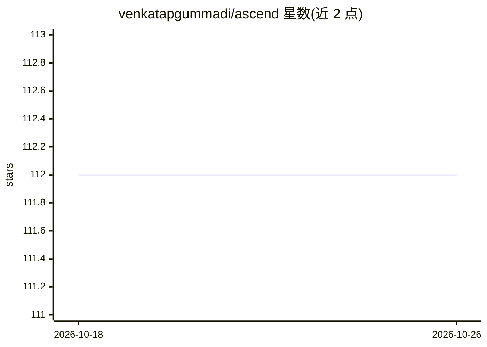

# venkatapgummadi/ascend

⭐ 112 · Python · MIT · 推送 2026-09-20 · [GitHub](https://github.com/venkatapgummadi/ascend) · [官网](https://github.com/venkatapgummadi/ascend) · 个人维护

**四层 DevSecOps 框架：安全扫描构建门禁与 AI 同步层**

面向 CI/CD 流水线的 DevSecOps 框架：四层架构覆盖源码分析（SAST/SCA/密钥检测）、容器与 IaC 扫描、多轨道部署（蓝绿/金丝雀/滚动）及可选的 AI 驱动代码同步（AST 差分、ML 冲突分类、LLM 解析加属性验证）。提供 GitHub Actions、GitLab CI、Jenkins、Azure DevOps 四平台参考配置，集成 Semgrep、CodeQL、Snyk、Trivy、ZAP 等扫描工具。附公开基准复现脚本与已录用 IEEE CARS 2026 论文，MIT 许可，Python 3.9+。

## 筛选速览

| 维度 | 判定 | 备注 |
|---|---|---|
| AI 角色 | `ai-enhanced` | 去掉 AI 部分产品仍成立 |
| 许可风险 | `permissive` | MIT |
| 部署形态 | `library` | 以包/库形式分发 |
| 模型依赖 | — | README 未给出锁定关系 |
| 硬件要求 | — | 无带数字的原话,不猜 |
| 安装摩擦 | `low` | 无编译、无系统依赖或容器化 |
| 成熟度 | — | 结构信号不足 |

## 能力要点

- 四层架构：扫描→构建门禁→多轨道部署→AI 同步
- 四平台 CI/CD 参考配置（GitHub Actions/GitLab/Jenkins/Azure DevOps）
- AI 同步层：AST 差分 + ML 冲突分类 + LLM 解析 + 属性验证
- 公开输入的基准复现脚本与已录用论文（IEEE CARS 2026）

## 适用场景

- 在 CI/CD 中把安全扫描变成构建门禁而非被动报告
- 拦截 AI 编程助手引入的缺陷与依赖漏洞
- 按阶段渐进式加固既有流水线

## 场景标签

`网络安全` · 领域:学习与行业

## 证据(README 行号)

> L5: A four-layer DevSecOps framework that integrates automated security scanning directly into CI/CD pipelines with buil
> L17: Modern CI/CD pipelines prioritize velocity. ASCEND's thesis is that velocity and security are not in tension — the 
> L62: ### 4. Enable the AI synchronization layer (optional)

## 星数曲线

2026-10-18 112 → 2026-10-26 112（+0）

---
*卡片 v1 · prompt 1.4 · 生成 2026-10-23 · 置信度 mid · 依据 README sha `94a7b9754dce` · [字段定义](../../DATASET.md)*
