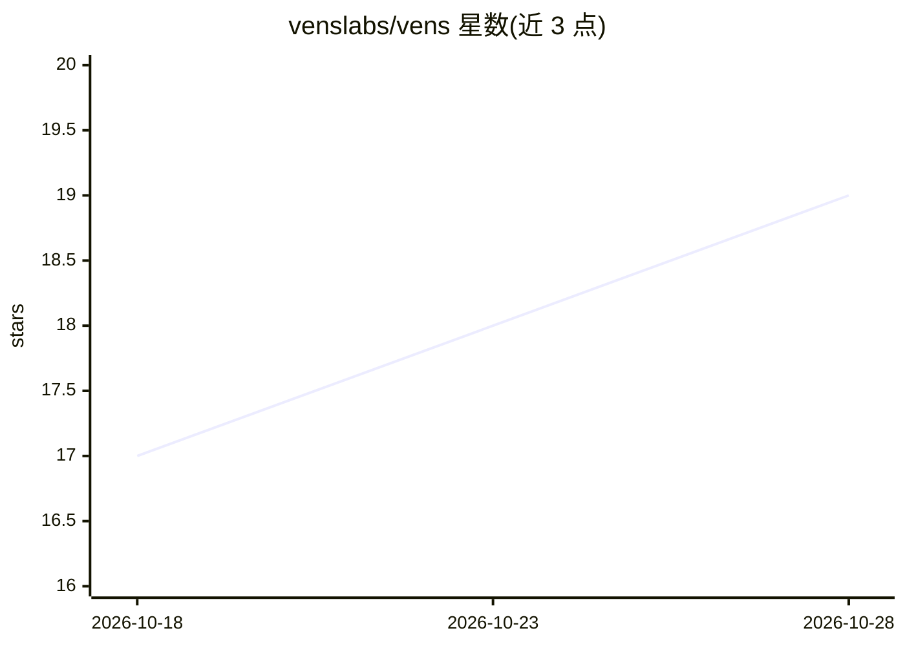

# venslabs/vens

⭐ 19 · Go · Apache-2.0 · 推送 2026-10-27 · [GitHub](https://github.com/venslabs/vens) · 组织维护

**用 LLM 按系统上下文对 CVE 做风险重评分的 CLI 工具**

读取 Trivy 或 Grype 的 JSON 扫描报告，结合用户在 config.yaml 中描述的系统上下文（暴露面、数据敏感度、合规要求、安全控制），由 LLM 对每个 CVE 计算 OWASP Risk Rating（0-81）评分，替代通用 CVSS 分级。输出 CycloneDX VEX 文件，可附 CycloneDX attestation 记录评分过程供审计；CI 门禁与 Dependency-Track 5.1+ 可消费该输出。提供 OpenAI、Anthropic、Google AI 与本地 Ollama 四种 LLM 通道，支持作为 GitHub Action、Go 安装或 Trivy 插件使用。

## 筛选速览

| 维度 | 判定 | 备注 |
|---|---|---|
| AI 角色 | `ai-native` | 本体是模型或模型工具 |
| 许可风险 | `permissive` | Apache-2.0 |
| 部署形态 | `library` | 以包/库形式分发 |
| 模型依赖 | local-ok | 支持本地模型 |
| 硬件要求 | — | 无带数字的原话,不猜 |
| 安装摩擦 | `low` | 无编译、无系统依赖或容器化 |
| 成熟度 | — | 结构信号不足 |

## 能力要点

- 读取 Trivy/Grype 报告并按系统上下文输出 OWASP 评分的 CycloneDX VEX
- --attest 写入 CycloneDX attestation 记录模型、种子、prompt/配置哈希与推理过程
- vens enrich 将 VEX 评分回写至 Trivy 报告
- 四种 LLM 通道：OpenAI、Anthropic、Google AI、本地 Ollama

## 适用场景

- 扫描出数百个 CVE 后按对我系统的真实风险排序处理
- CI 门禁按上下文风险评分决定是否阻断构建
- 在 Dependency-Track 中为每个 finding 附带上下文风险评分

## 场景标签

`网络安全` · 领域:学习与行业

## 证据(README 行号)

> L10: **Your scanner found 300 CVEs. Which ones actually matter?** Vens takes a Trivy or Grype report, combines it with a
> L15:  vens takes a scanner report and your system context, scores every CVE with an LLM, and emits a CycloneDX VEX plus 

## 星数曲线

2026-10-18 17 → 2026-10-28 19（+2）

---
*卡片 v1 · prompt 1.4 · 生成 2026-10-28 · 置信度 high · 依据 README sha `6154b8713363` · [字段定义](../../DATASET.md)*
