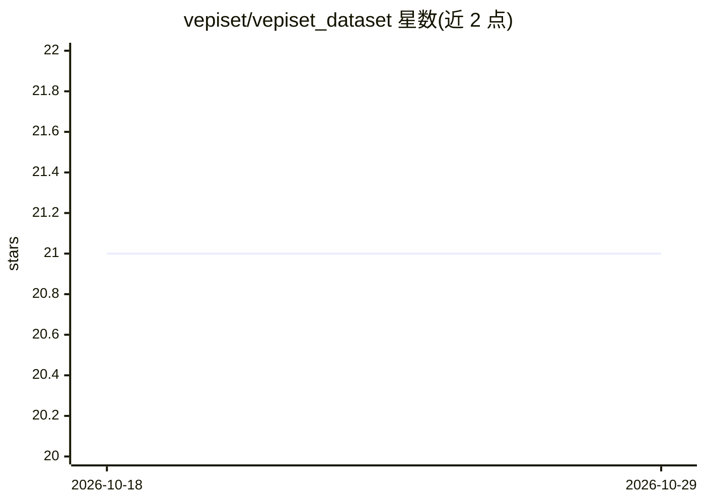

# vepiset/vepiset_dataset

⭐ 21 · Python · 推送 2025-12-19 · [GitHub](https://github.com/vepiset/vepiset_dataset) · [官网](https://www.vepiset.com) · 组织维护 · 中文 README

**癫痫棘波 EEG 开放数据集及 IED 检测训练代码**

由北京协和医院癫痫中心 sourced 的开放 EEG 数据集（vEpiSet），发布 84 个 MAT 文件，每个含 29 个电极（19 个国际 10-20 系统电极、4 个耳电极、2 个 ECG 与 4 个 EMG 电极），EDF 注释中标注三类放电事件。仓库同时提供配套深度学习流程：MAT 转 Numpy、生成 CSV、配置后用 train.py 训练、eval.py 评估，数据集 IED 2516 条、non-IED 22933 条（IED 占 9.886%），并给出 5 折交叉验证结果（IED 类 F1 0.808）。面向癫痫 EEG 研究者。

## 筛选速览

| 维度 | 判定 | 备注 |
|---|---|---|
| AI 角色 | `ai-knowledge` | 知识聚合/清单类 |
| 许可风险 | `none` | — |
| 部署形态 | `library` | 以包/库形式分发 |
| 模型依赖 | — | README 未给出锁定关系 |
| 硬件要求 | — | 无带数字的原话,不猜 |
| 安装摩擦 | `low` | 无编译、无系统依赖或容器化 |
| 成熟度 | — | 结构信号不足 |

## 能力要点

- 84 个 MAT 文件、29 电极配置（EEG/ECG/EMG）的癫痫棘波数据集
- EDF 注释标注三类放电事件标识符
- 提供 mat2npy/numpy2csv 预处理与 train/eval 训练评估脚本
- 数据集 IED:non-IED = 2516:22933，附 5 折交叉验证结果

## 适用场景

- 下载癫痫间期癫痫样放电（IED）检测的公开 EEG 数据
- 复现或开发 CNN 深度学习的棘波检测模型
- 研究含 ECG/EMG 通道的多模态 EEG 数据处理

## 场景标签

 · 领域:医疗/脑电信号

## 证据(README 行号)

> L3: We are delighted to introduce our open-source dataset, the Epileptic Spike Dataset, sourced from the Epilepsy Center
> L5: We have released 84 MAT files, each including 29 electrodes: 19 standard 10-20 system electrodes, 4 auricular electr
> L65: |Category|IED|non-IED|

## 星数曲线

2026-10-18 21 → 2026-10-29 21（+0）

---
*卡片 v1 · prompt 1.4 · 生成 2026-10-28 · 置信度 mid · 依据 README sha `c4f2b7e70a33` · [字段定义](../../DATASET.md)*
