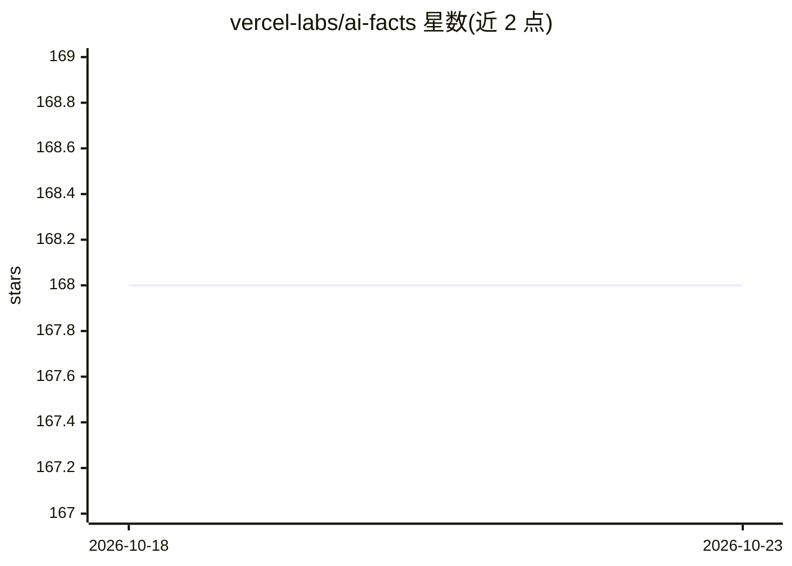

# vercel-labs/ai-facts

⭐ 168 · TypeScript · 推送 2026-04-25 · [GitHub](https://github.com/vercel-labs/ai-facts) · [官网](https://ai-facts.vercel.app) · 组织维护

**实时核验口语陈述真伪的 Next.js 应用**

基于 Next.js 的网页应用，对用户麦克风采集的语音做实时事实核查：Deepgram 转录音频流，文本按标点切分出独立陈述，经 Vercel AI Gateway 路由到 OpenAI 与 Perplexity 交叉核验，实时展示每条陈述的真伪判定及解释。UI 使用 ShadcnUI 与 Tailwind CSS。需配置 AI Gateway 与 Deepgram 的 API key，支持 Vercel 一键部署；README 提示 LLM 可能给出错误或过时信息。

## 筛选速览

| 维度 | 判定 | 备注 |
|---|---|---|
| AI 角色 | `ai-native` | 本体是模型或模型工具 |
| 许可风险 | `none` | — |
| 部署形态 | `library` | 以包/库形式分发 |
| 模型依赖 | — | README 未给出锁定关系 |
| 硬件要求 | — | 无带数字的原话,不猜 |
| 安装摩擦 | `low` | 无编译、无系统依赖或容器化 |
| 成熟度 | — | 结构信号不足 |

## 能力要点

- Deepgram 实时音频转录
- OpenAI 与 Perplexity 双通道交叉核验陈述
- 逐条展示真伪判定与解释，实时更新
- 支持 Vercel 一键部署，部署后经 OIDC 自动鉴权

## 适用场景

- 演讲或访谈中实时核查口述内容的真实性
- 语言学习或演示中即时验证事实陈述
- 体验 AI SDK 与 AI Gateway 组合的事实核查流程

## 场景标签

 · 领域:AI 应用/事实核查

## 证据(README 行号)

> L7: This project is a Next.js application that performs real-time fact checking on spoken statements. It uses Deepgram f
> L11: - Real-time Audio Transcription: Captures and transcribes spoken audio using Deepgram's API

## 星数曲线

2026-10-18 168 → 2026-10-23 168（+0）

---
*卡片 v1 · prompt 1.4 · 生成 2026-10-22 · 置信度 high · 依据 README sha `cec3129b8271` · [字段定义](../../DATASET.md)*
