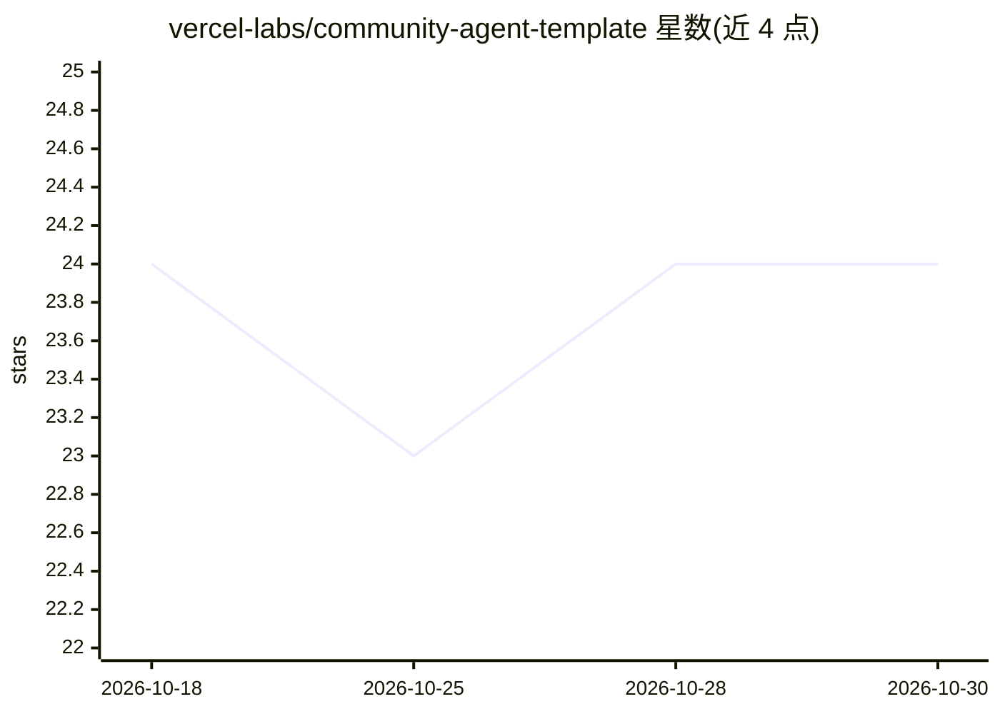

# vercel-labs/community-agent-template

⭐ 24 · TypeScript · MIT · 推送 2026-05-21 · [GitHub](https://github.com/vercel-labs/community-agent-template) · [官网](https://community-agent.labs.vercel.dev) · 组织维护

**给 Slack 社区管理者的 AI 机器人模板，附 Next.js 管理面板**

Vercel Labs 出品的开源模板：Fork 后部署到 Vercel，得到一个 AI 社区管理 Slack 机器人。机器人由 AI SDK 驱动，负责路由问题、欢迎新成员、找出未回复的帖子并向管理员标记问题；支持按频道配置路由、限定域名范围的 Anthropic 网络搜索、可选沙箱命令执行，LLM 调用与工具执行通过 Vercel Workflow 做检查点与自动重试。内置带 Slack OAuth 的实时管理面板，可先以演示模式（mock 数据）体验。需连接 Slack 工作区方可用于真实社区。

## 筛选速览

| 维度 | 判定 | 备注 |
|---|---|---|
| AI 角色 | `ai-native` | 本体是模型或模型工具 |
| 许可风险 | `permissive` | MIT |
| 部署形态 | `None` |  |
| 模型依赖 | — | README 未给出锁定关系 |
| 硬件要求 | — | 无带数字的原话,不猜 |
| 安装摩擦 | `low` | 无编译、无系统依赖或容器化 |
| 成熟度 | — | 结构信号不足 |

## 能力要点

- AI SDK 驱动的社区管理 agent：路由问题、欢迎成员、标记未回复帖
- Vercel Workflow 持久化工作流，LLM 调用与工具执行带检查点和自动重试
- 限定 SEARCH_DOMAINS 的 Anthropic 网络搜索（经 AI Gateway）
- 内置实时管理面板，支持无 Slack 的演示模式

## 适用场景

- 为自己的 Slack 社区部署一个自动答疑和管理的机器人
- 通过管理面板实时查看社区活动与对话
- 基于模板定制机器人人格、频道路由与工具

## 场景标签

`聊天机器人` · 领域:对话与助手

## 证据(README 行号)

> L3: Open source AI-powered Slack community management bot with a built-in Next.js admin panel. Uses Chat SDK, AI SDK, an
> L11: - **Community manager AI**—routes questions, welcomes members, surfaces unanswered threads, and flags issues to a l

## 星数曲线

2026-10-18 24 → 2026-10-30 24（+0）

---
*卡片 v1 · prompt 1.4 · 生成 2026-10-27 · 置信度 high · 依据 README sha `dd2f812203c7` · [字段定义](../../DATASET.md)*
