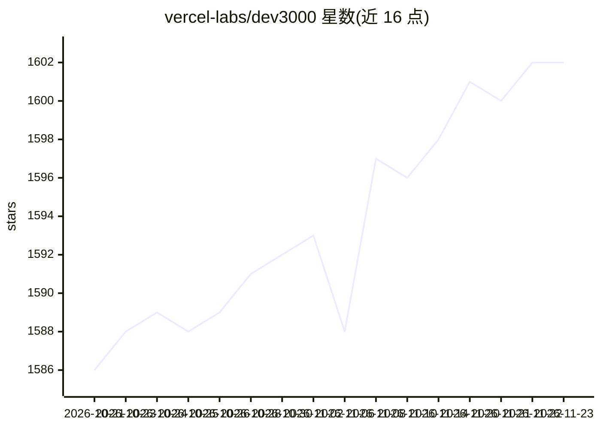

# vercel-labs/dev3000

⭐ 1,602 · TypeScript · MIT · 推送 2026-11-18 · [GitHub](https://github.com/vercel-labs/dev3000) · [官网](https://dev3000.ai) · 组织维护

**给编码 agent 提供托管浏览器与统一调试时间线**

d3k 为编码 agent 提供一个受管浏览器和共享时间线，将服务端输出、浏览器控制台消息、异常、网络请求与交互事件按统一时间戳收集，供 agent 复现问题并读取证据。支持 cursor 增量读取、错误过滤、截图命令，网络证据含脱敏头与耗时指标，时间线上限 5,000 条事件或 8 MiB，退出即消失。本地模式由 runtime 管理启动；远程模式经 Vercel Sandbox 在远端克隆并运行项目，本地 Chrome 陪跑，Sandbox 模式目前仅限 macOS。

## 筛选速览

| 维度 | 判定 | 备注 |
|---|---|---|
| AI 角色 | `ai-ecosystem` | LLM/agent 周边工具 |
| 许可风险 | `permissive` | MIT |
| 部署形态 | `library` | 以包/库形式分发 |
| 模型依赖 | — | README 未给出锁定关系 |
| 硬件要求 | — | 无带数字的原话,不猜 |
| 安装摩擦 | `low` | 无编译、无系统依赖或容器化 |
| 成熟度 | — | 结构信号不足 |

## 能力要点

- server 与 browser 事件共享序号的统一时间线（上限 5,000 事件/8 MiB）
- 网络证据含脱敏请求/响应头、CDP 计时与请求体预览
- 远程模式连接 Vercel Sandbox，无需本地项目 checkout
- macOS OS 级沙箱策略限制 Chrome 文件与剪贴板访问

## 适用场景

- 让 agent 复现 checkout 流程的 bug 并读取事件证据
- 调试时把服务端日志与浏览器控制台/网络事件对齐查看
- 远端项目在本地 Chrome 中验证，本地不留仓库

## 场景标签

`编码 Agent` `浏览器自动化` · 领域:效率与自动化

## 证据(README 行号)

> L3: d3k gives your coding agent a managed browser and a shared timeline of server output, browser console messages, exce
> L5: Install the skill, then ask your agent to run the project, reproduce an issue, and inspect what happened:

## 星数曲线

2026-10-21 1,586 → 2026-11-23 1,602（+16）

---
*卡片 v1 · prompt 1.4 · 生成 2026-11-23 · 置信度 mid · 依据 README sha `c884036888a0` · [字段定义](../../DATASET.md)*
