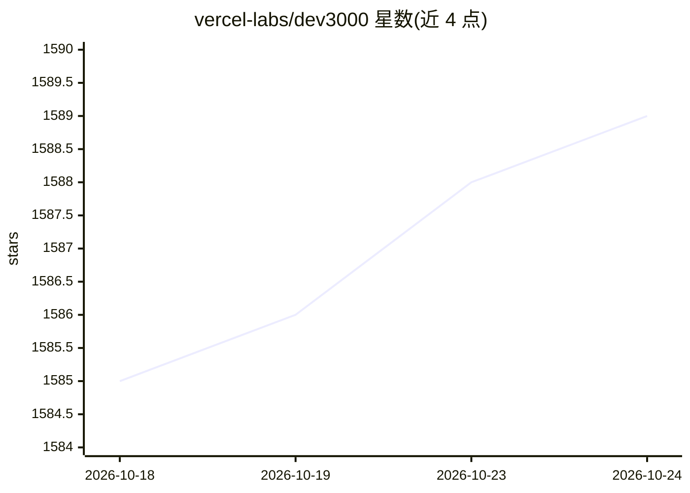

# vercel-labs/dev3000

⭐ 1,589 · TypeScript · MIT · 推送 2026-10-23 · [GitHub](https://github.com/vercel-labs/dev3000) · [官网](https://dev3000.ai) · 组织维护

**给编码代理的本地 Web 调试运行时：统一采集开发时间线**

面向编码代理（coding agent）的本地 Web 调试运行时：启动 dev server，打开受管理的 Chrome 浏览器（项目级稳定 profile），并把服务端日志、浏览器错误、网络请求、用户交互与截图汇入一条带时间戳的统一时间线。默认通过 Portless 为每个应用提供稳定的本地 HTTPS URL，端口变化不影响浏览器状态。主要接口是 d3k 技能，让代理以非交互方式接管运行时并读取统一证据；也保留独立 TUI。支持 Next.js/Vite/React/Vue/Svelte/Astro/Django/Flask/FastAPI/Rails 等项目的自动检测。需 Node.js 24+，Portless 一次性配置需管理员授权。

## 筛选速览

| 维度 | 判定 | 备注 |
|---|---|---|
| AI 角色 | `ai-ecosystem` | LLM/agent 周边工具 |
| 许可风险 | `permissive` | MIT |
| 部署形态 | `library` | 以包/库形式分发 |
| 模型依赖 | — | README 未给出锁定关系 |
| 硬件要求 | — | 无带数字的原话,不猜 |
| 安装摩擦 | `low` | 无编译、无系统依赖或容器化 |
| 成熟度 | — | 结构信号不足 |

## 能力要点

- 统一时间线采集：服务端日志、浏览器错误、网络请求、交互、截图、DevTools 事件
- 项目级稳定 Portless URL 与持久化 Chrome profile（登录态跨会话保留）
- d3k 技能让编码代理非交互启动并接管运行时（支持 claude/codex/opencode）
- 自动检测常见 Web 框架项目，可用 --command 自定义 dev server

## 适用场景

- 让编码代理在复现 bug 时读取统一日志与截图进行调试
- OAuth 等登录敏感流程中保留浏览器身份跨会话调试
- 开发者用独立 TUI 终端面板查看应用的完整开发时间线

## 场景标签

 · 领域:开发者工具/Web 调试

## 证据(README 行号)

> L3: d3k is an agent-first local web debugging runtime. It starts your dev server, opens a monitored browser with a proje
> L33: Install the d3k skill for your coding agents:

## 星数曲线

2026-10-18 1,585 → 2026-10-24 1,589（+4）

---
*卡片 v1 · prompt 1.4 · 生成 2026-10-21 · 置信度 high · 依据 README sha `23dc9b4dbd2d` · [字段定义](../../DATASET.md)*
