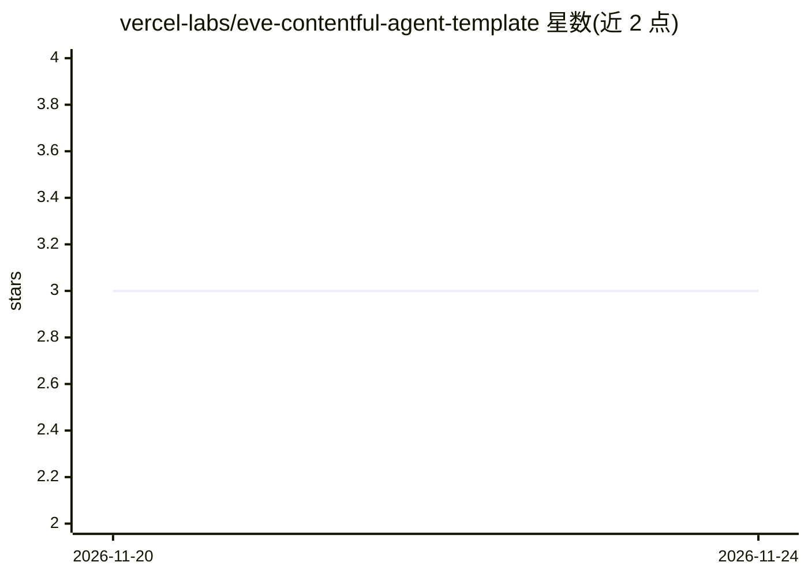

# vercel-labs/eve-contentful-agent-template

⭐ 3 · TypeScript · MIT · 推送 2026-11-20 · [GitHub](https://github.com/vercel-labs/eve-contentful-agent-template) · [官网](https://vercel.com/templates/other/eve-contentful-agent) · 组织维护

**基于 eve 的 Slack 端 Contentful 内容编辑助手模板**

一个面向内容团队的项目模板：在 Slack 中通过 @mention 与 agent 对话，直接起草和编辑 Contentful 条目与资产，发布默认需经 Slack 卡片审批。机制上由 Vercel Drives 同步内容副本供搜索与 DuckDB SQL 查询，按用户将写作偏好存入 Vercel Blob。部署走 Vercel 项目流程并需配置 Contentful API token 等环境变量；本地开发要求 Node.js 24 与 pnpm，本地会话不访问 Drives 副本而直查 Contentful。

## 筛选速览

| 维度 | 判定 | 备注 |
|---|---|---|
| AI 角色 | `ai-native` | 本体是模型或模型工具 |
| 许可风险 | `permissive` | MIT |
| 部署形态 | `library` | 以包/库形式分发 |
| 模型依赖 | — | README 未给出锁定关系 |
| 硬件要求 | — | 无带数字的原话,不猜 |
| 安装摩擦 | `low` | 无编译、无系统依赖或容器化 |
| 成熟度 | — | 结构信号不足 |

## 能力要点

- Slack 内直接起草/编辑 Contentful 条目并审批发布请求
- Vercel Drives 同步内容副本，支持搜索与 DuckDB SQL 查询
- 按用户存储写作偏好（语气、语言）于私有 Blob 存储
- 资产上传处理，结果可呈现为表格或图表

## 适用场景

- 内容团队在 Slack 里直接改稿并走审批发布流程
- 用自然语言或 SQL 检索已同步的 Contentful 内容
- 让 agent 记住每位作者的语气与语言偏好

## 场景标签

`聊天机器人` `AI 写作` · 领域:对话与助手

## 证据(README 行号)

> L5: Slack-based Contentful assistant built on eve, with Vercel Drives providing a searchable copy of your content that t
> L24: |Agent framework|eve|

## 星数曲线

2026-11-20 3 → 2026-11-24 3（+0）

---
*卡片 v1 · prompt 1.4 · 生成 2026-11-21 · 置信度 high · 依据 README sha `5fbb735862d9` · [字段定义](../../DATASET.md)*
