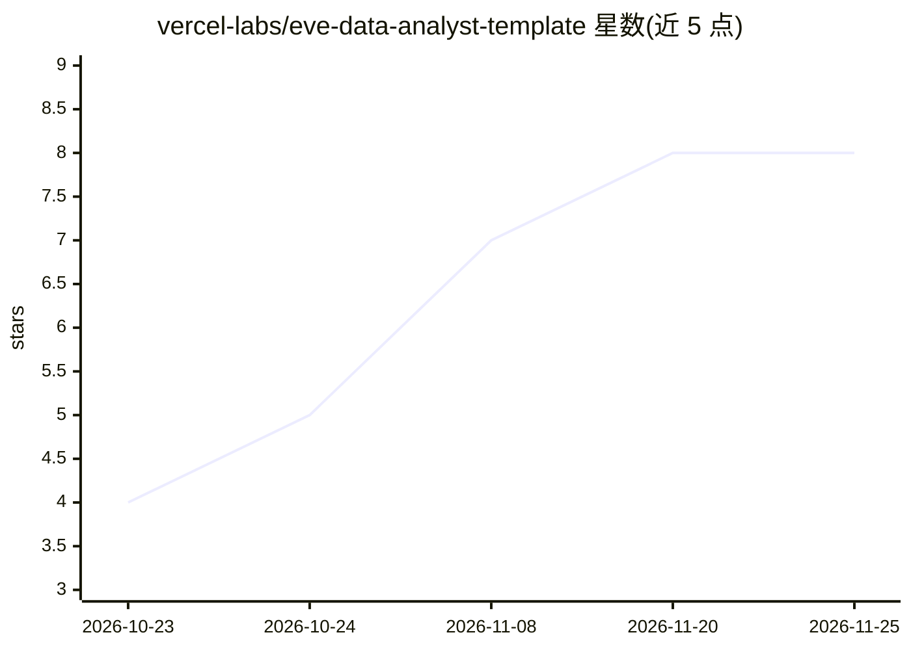

# vercel-labs/eve-data-analyst-template

⭐ — · [GitHub]() · 组织维护

**基于 eve 的 Slack 数据分析 Agent 模板，用自然语言查询 Postgres**

Vercel 提供的 Agent 模板：在 Slack 中 @机器人提问（如上月 MRR），Agent 从 Postgres 数据库查询并回复数字，需要时附图表或表格。回答流程：读取可用表与列描述、加载团队自定义的指标定义文件、执行汇总查询并给出数值/时段/时区，答案下方展示所用 SQL。安全机制包括只读事务、单条 SELECT 包装、查询成本预估与人工审批、关闭外发网络，以及按 Slack 用户映射 Postgres 角色的访问控制。通过 Vercel 一键部署，需 Postgres 14+。

## 筛选速览

| 维度 | 判定 | 备注 |
|---|---|---|
| AI 角色 | `ai-native` | 本体是模型或模型工具 |
| 许可风险 | `permissive` | — |
| 部署形态 | `self-host` | docker 或自建部署 |
| 模型依赖 | — | README 未给出锁定关系 |
| 硬件要求 | — | 无带数字的原话,不猜 |
| 安装摩擦 | `low` | 无编译、无系统依赖或容器化 |
| 成熟度 | — | 结构信号不足 |

## 能力要点

- Agent 回答时展示所运行的 SQL、读取的表与执行时间
- 指标定义存于 agent/skills/metric-definitions.md，按团队口径计算
- 只读事务 + 查询成本预估 + 人工审批的安全机制
- ANALYST_ROLE_MAP 将 Slack 用户/频道映射到 Postgres 角色

## 适用场景

- 在 Slack 里用自然语言查询公司业务数据
- 让团队成员按各自数据库权限自助取数
- 用演示数据快速试用数据分析 Agent 的搭建流程

## 场景标签

`数据分析` `聊天机器人` · 领域:效率与自动化

## 证据(README 行号)

> L5: Slack-based data analyst built on eve that answers questions about your business from a Postgres database. Ask "What
> L38: The agent looks up which tables it can read and what their columns mean, then loads your metric definitions from ag
> L30: |Agent framework|eve|

## 星数曲线

2026-10-23 4 → 2026-11-25 8（+4）

---
*卡片 v1 · prompt 1.4 · 生成 2026-11-20 · 置信度 mid · 依据 README sha `72914c82ab17` · [字段定义](../../DATASET.md)*
