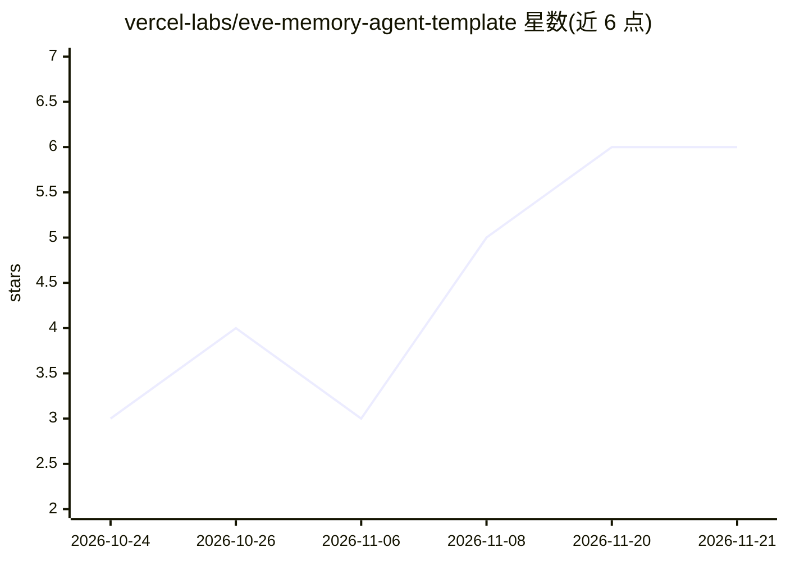

# vercel-labs/eve-memory-agent-template

⭐ 6 · TypeScript · MIT · 推送 2026-11-20 · [GitHub](https://github.com/vercel-labs/eve-memory-agent-template) · [官网](https://vercel.com/templates/eve/eve-memory-agent) · 组织维护

**保存并回忆用户偏好的 Slack AI 助手模板**

基于 eve 框架构建的 Slack 助手模板：将用户口头分享的偏好按用户级与频道级两类记忆分别保存，并在每次对话开始时召回；记忆绑定经校验的 Slack 用户与频道身份，存储于 Vercel Blob 私有存储。提供 Vercel 一键部署流程，本地开发用 Node.js 24 与 pnpm，模型经 Vercel AI Gateway 接入。本地会话用 just-bash 替代 Sandbox 且不查询 Slack 资料。

## 筛选速览

| 维度 | 判定 | 备注 |
|---|---|---|
| AI 角色 | `ai-native` | 本体是模型或模型工具 |
| 许可风险 | `permissive` | MIT |
| 部署形态 | `library` | 以包/库形式分发 |
| 模型依赖 | — | README 未给出锁定关系 |
| 硬件要求 | — | 无带数字的原话,不猜 |
| 安装摩擦 | `low` | 无编译、无系统依赖或容器化 |
| 成熟度 | — | 结构信号不足 |

## 能力要点

- 用户偏好与频道约定分两份记忆文件保存，各自带保存/删除工具
- 记忆绑定经校验的 Slack 用户与频道身份，DM 仅用用户记忆
- Slack 身份注入：将参与者姓名与头像加入上下文，不含邮箱
- 可通过 Vercel Drives 挂载团队维护的参考文档供检索

## 适用场景

- 在 Slack 中@机器人让其记住个人偏好并延续执行
- 让同一频道成员共享并遵守频道级约定
- 为团队助手挂载 runbook 或术语表等长期参考文档

## 场景标签

`AI 助手` `Agent 记忆` · 领域:Agent 开发

## 证据(README 行号)

> L5: Slack-based assistant built on eve that saves the preferences people share with it. Personal preferences and shared 
> L19: |Agent framework|eve|
> L34: Before the agent responds to each message, eve recalls both memories, and the model saves or removes entries with e

## 星数曲线

2026-10-24 3 → 2026-11-21 6（+3）

---
*卡片 v1 · prompt 1.4 · 生成 2026-11-20 · 置信度 mid · 依据 README sha `b692acad5bf6` · [字段定义](../../DATASET.md)*
