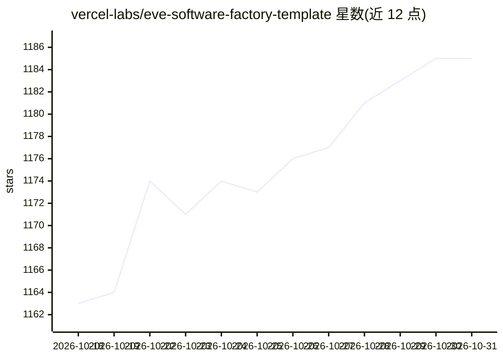

# vercel-labs/eve-software-factory-template

⭐ 1,185 · TypeScript · MIT · 推送 2026-10-23 · [GitHub](https://github.com/vercel-labs/eve-software-factory-template) · [官网](https://vercel.com/templates/eve/eve-software-factory) · 组织维护

**面向 GitHub/Linear 的 AI 代理软件工厂模板，产出草稿 PR**

Vercel 官方实验室提供的 eve 软件工厂模板，名为 Foreman：从 GitHub issue 与 Linear 任务接收工作项，经分类器、分析师、实现者、评审者四个站点代理依次处理，在独立沙箱中执行计划并用仓库自身检查验证，最终推送草稿 PR 供人审阅合并。评审者只看分支与真实 diff，不读实现者推理；各次运行之间维护仓库笔记形式的 factory brain。通过 Vercel 一键部署，配置 FACTORY_REPO 等环境变量后运行，也可用本地 TUI（本地运行视为不可信，改动需人工批准）。

## 筛选速览

| 维度 | 判定 | 备注 |
|---|---|---|
| AI 角色 | `ai-native` | 本体是模型或模型工具 |
| 许可风险 | `permissive` | MIT |
| 部署形态 | `library` | 以包/库形式分发 |
| 模型依赖 | — | README 未给出锁定关系 |
| 硬件要求 | — | 无带数字的原话,不猜 |
| 安装摩擦 | `low` | 无编译、无系统依赖或容器化 |
| 成熟度 | — | 结构信号不足 |

## 能力要点

- 四站点代理流水线：分类→分析→实现→独立评审
- 每个站点拥有独立指令、沙箱与工具，评审者只看分支与真实 diff
- 支持 GitHub 标签/提及、Linear 委派、本地 TUI、CI 失败自动诊断修复等六种工作入口
- Vercel 一键部署并自动配置 GitHub/Linear 连接器与 Blob 存储

## 适用场景

- 给仓库贴 factory 标签让 AI 代理自动产出草稿 PR
- 在 Linear 中委派任务并由代理汇报进度
- 本地通过 TUI 交给代理任务，改动经批准后才推送

## 场景标签

`编码 Agent` `代码审查` · 领域:编码与开发

## 证据(README 行号)

> L9: Meet **Foreman**, an eve software factory that puts AI agents on every stage of the development loop and keeps peopl
> L17: - **Classifier** triages the task: type, priority, complexity, actionable or not. When the task isn't actionable, F
> L19: - **Implementer** executes the plan in its own sandbox, verifies with your repo's own checks, and pushes a branch.

## 星数曲线

2026-10-18 1,163 → 2026-10-31 1,185（+22）

---
*卡片 v1 · prompt 1.4 · 生成 2026-10-21 · 置信度 mid · 依据 README sha `acd93755cba7` · [字段定义](../../DATASET.md)*
