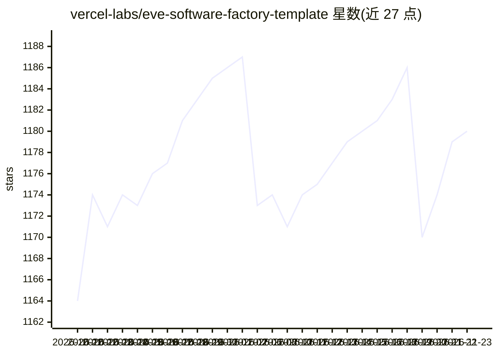

# vercel-labs/eve-software-factory-template

⭐ 1,180 · TypeScript · MIT · 推送 2026-11-20 · [GitHub](https://github.com/vercel-labs/eve-software-factory-template) · [官网](https://vercel.com/templates/eve/eve-software-factory) · 组织维护

**让 AI agent 走完开发流水线的软件工厂模板**

Foreman 是基于 eve Agent Stack 的软件工厂模板：从 GitHub issue、Linear 或 HTTP 接收任务，经分类、调研、规划、实现、评审五个独立 agent 站点处理后交付草稿 PR。安全机制包括每命令窄化凭证、命令白名单、只读沙箱、沙箱出口域名限制、分支前缀限制与强制分支保护。通过 Vercel 一键部署，本地用 pnpm dev 运行 TUI，配置项覆盖 token 回退、签名提交、安装脚本等。

## 筛选速览

| 维度 | 判定 | 备注 |
|---|---|---|
| AI 角色 | `ai-ecosystem` | LLM/agent 周边工具 |
| 许可风险 | `permissive` | MIT |
| 部署形态 | `library` | 以包/库形式分发 |
| 模型依赖 | — | README 未给出锁定关系 |
| 硬件要求 | — | 无带数字的原话,不猜 |
| 安装摩擦 | `low` | 无编译、无系统依赖或容器化 |
| 成熟度 | — | 结构信号不足 |

## 能力要点

- 五站点 agent 流水线：分类→调研→规划→实现→评审，产出草稿 PR
- 每命令窄化凭证与命令白名单，token 不进入沙箱
- 沙箱默认仅可达 GitHub 与公共包注册表的出口限制
- 七种任务入口：标签、@mention、Linear、HTTP、TUI、CI 失败、外部 PR

## 适用场景

- 给仓库 issue 打标签自动生成草稿 PR
- CI 失败时自动诊断并推送修复分支
- 通过 HTTP API 把外部系统工单交给流水线处理

## 场景标签

`编码 Agent` `多智能体` · 领域:Agent 开发

## 证据(README 行号)

> L6: Meet **Foreman**, an eve software factory that puts AI agents on every stage of the development loop and keeps peopl
> L20: Each station is its own agent with its own instructions, sandbox, and tools. The Reviewer sees only the pushed bran

## 星数曲线

2026-10-21 1,164 → 2026-11-23 1,180（+16）

---
*卡片 v1 · prompt 1.4 · 生成 2026-11-23 · 置信度 low · 依据 README sha `84190bc7773a` · [字段定义](../../DATASET.md)*
