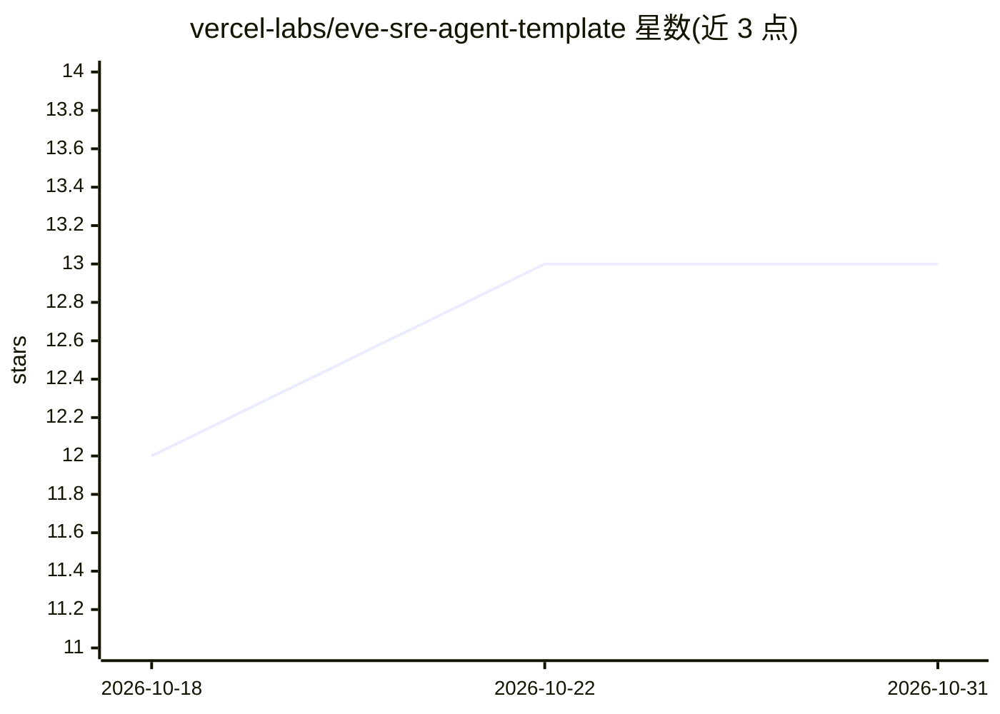

# vercel-labs/eve-sre-agent-template

⭐ 13 · TypeScript · MIT · 推送 2026-10-23 · [GitHub](https://github.com/vercel-labs/eve-sre-agent-template) · [官网](https://vercel.com/kb/guide/eve-incident-sre-agent) · 组织维护

**面向 Slack 的 SRE 事件响应 agent 模板，跨工具排查告警**

基于 Vercel eve agent 栈构建的 Slack 事件响应 agent 模板：通过 @提及、监听频道消息或 webhook 触发调查，聚合 Datadog、GitHub、Vercel 等工具的可观测性数据排查告警与事件。调查默认只读，记录带来源链接的发现，回答先给结论再附证据。支持在 Slack 中创建全局/个人 runbook、通过 Vercel Connect 扩展工具、以及 POST /v1/investigage webhook 自动化触发；一键部署到 Vercel 并预配 Slack/GitHub/Datadog 连接器与 Vercel Blob 存储。

## 筛选速览

| 维度 | 判定 | 备注 |
|---|---|---|
| AI 角色 | `ai-native` | 本体是模型或模型工具 |
| 许可风险 | `permissive` | MIT |
| 部署形态 | `library` | 以包/库形式分发 |
| 模型依赖 | — | README 未给出锁定关系 |
| 硬件要求 | — | 无带数字的原话,不猜 |
| 安装摩擦 | `low` | 无编译、无系统依赖或容器化 |
| 成熟度 | — | 结构信号不足 |

## 能力要点

- 三种调查触发方式：Slack 提及/DM、频道监听、webhook 调用
- 聚合 Datadog、GitHub、Vercel 等数据源，调查默认只读并附来源链接
- 一键部署 Vercel 并预配 Slack/GitHub/Datadog/Vercel MCP 连接器
- 支持在 Slack 中创建全局与个人 runbook（依赖 Vercel Blob 存储）

## 适用场景

- 在 Slack 中让 agent 排查 Datadog 告警并汇总证据
- 通过 webhook 从外部系统自动触发事件调查
- 为重复出现的告警沉淀可复用的 runbook

## 场景标签

`Agent 框架` · 领域:Agent 开发

## 证据(README 行号)

> L8: sre is an eve incident response agent for Slack. It brings together the observability data you need to debug an aler
> L10: Mention `@sre`, watch a channel for alerts, or invoke it from an external system with a webhook. The agent checks h
> L22: The agent records novel, decision-relevant findings with source links. Each investigation turn has its own evidence

## 星数曲线

2026-10-18 12 → 2026-10-31 13（+1）

---
*卡片 v1 · prompt 1.4 · 生成 2026-10-31 · 置信度 mid · 依据 README sha `617306c1dc26` · [字段定义](../../DATASET.md)*
