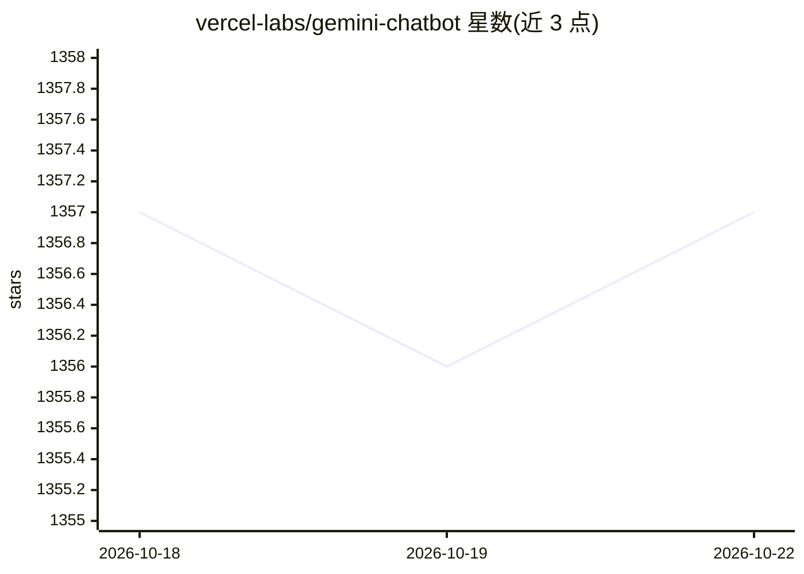

# vercel-labs/gemini-chatbot

⭐ 1,355 · TypeScript · NOASSERTION · 推送 2026-05-27 · [GitHub](https://github.com/vercel-labs/gemini-chatbot) · [官网](https://gemini.vercel.ai) · 组织维护

**基于 Next.js 与 Vercel AI SDK 的开源聊天机器人模板**

由 Vercel Labs 维护的开源 AI 聊天机器人模板，基于 Next.js 14 App Router、React Server Components 与 Vercel AI SDK 构建，默认接入 Google Gemini gemini-1.5-pro 模型，也可切换 OpenAI、Anthropic、Cohere 等提供商。附带 shadcn/ui 样式、Vercel Postgres 聊天记录持久化、Vercel Blob 对象存储与 NextAuth.js 认证。面向想快速部署自有聊天机器人的开发者，支持一键部署到 Vercel 或本地 pnpm 运行，需配置环境变量。

## 筛选速览

| 维度 | 判定 | 备注 |
|---|---|---|
| AI 角色 | `ai-native` | 本体是模型或模型工具 |
| 许可风险 | `none` | NOASSERTION |
| 部署形态 | `library` | 以包/库形式分发 |
| 模型依赖 | — | README 未给出锁定关系 |
| 硬件要求 | — | 无带数字的原话,不猜 |
| 安装摩擦 | `low` | 无编译、无系统依赖或容器化 |
| 成熟度 | — | 结构信号不足 |

## 能力要点

- 默认 Google Gemini gemini-1.5-pro，可切换 OpenAI/Anthropic/Cohere 等提供商
- Next.js 14 App Router + React Server Components 架构
- Vercel Postgres 聊天历史持久化与 NextAuth.js 认证
- 支持一键部署到 Vercel

## 适用场景

- 快速搭建并部署自己的 AI 聊天机器人
- 作为 Next.js + AI SDK 项目的起步模板
- 学习多模型提供商的接入与切换

## 场景标签

 · 领域:Web 应用/LLM 聊天

## 证据(README 行号)

> L6:  An Open-Source AI Chatbot Template Built With Next.js and the AI SDK by Vercel.
> L18: - AI SDK
> L21:  - Supports Google (default), OpenAI, Anthropic, Cohere, and other model providers

## 星数曲线

2026-10-18 1,357 → 2026-10-22 1,357（+0）

---
*卡片 v1 · prompt 1.4 · 生成 2026-10-21 · 置信度 high · 依据 README sha `eb8a27793484` · [字段定义](../../DATASET.md)*
