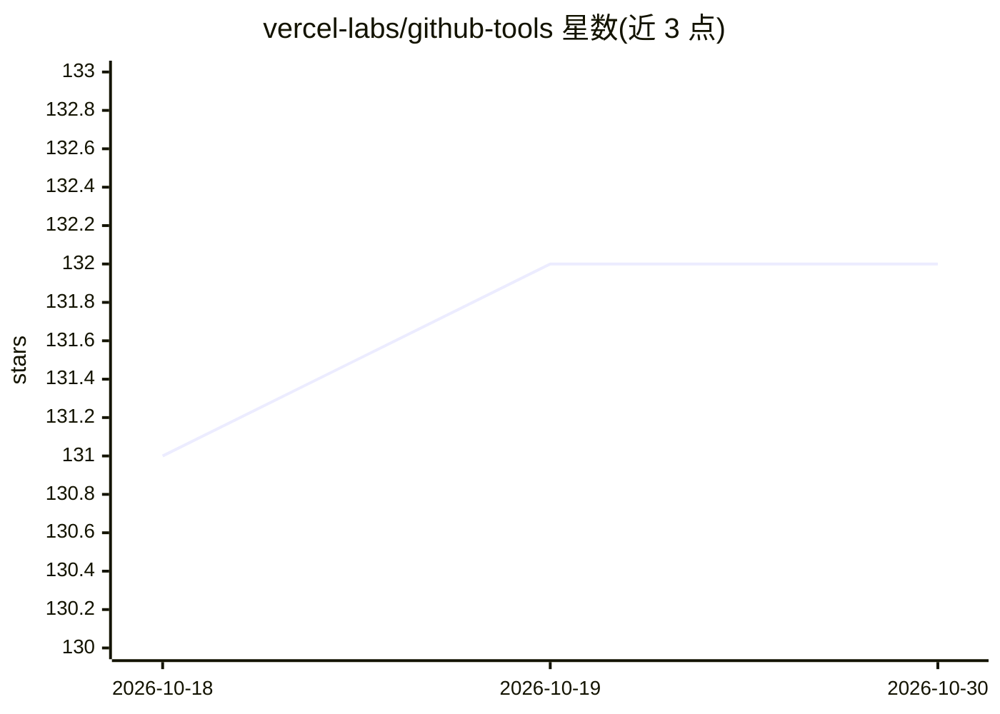

# vercel-labs/github-tools

⭐ 132 · TypeScript · MIT · 推送 2026-10-21 · [GitHub](https://github.com/vercel-labs/github-tools) · [官网](https://github-tools.com) · 组织维护

**给 agent 提供 GitHub API 工具层的 TypeScript SDK**

面向构建 GitHub AI agent 的开发者，将 GitHub API 封装为 Vercel AI SDK / TanStack AI 类型的工具集：84 个工具覆盖仓库、PR、issue、CI、release 等，提供 10 个内置 preset 按任务收敛工具面，写操作默认需人工批准（可选 auto 模式由评估模型打分放行低风险调用），工具内部使用 "use step" 支持在 Vercel Workflow 中断点续跑。输出按上下文窗口做截断塑形，附带 rateLimit 元数据与带 code/why/fix 的结构化错误目录。以 npm 包分发，peer 依赖为 ai 与 zod。

## 筛选速览

| 维度 | 判定 | 备注 |
|---|---|---|
| AI 角色 | `ai-ecosystem` | LLM/agent 周边工具 |
| 许可风险 | `permissive` | MIT |
| 部署形态 | `library` | 以包/库形式分发 |
| 模型依赖 | — | README 未给出锁定关系 |
| 硬件要求 | — | 无带数字的原话,不猜 |
| 安装摩擦 | `low` | 无编译、无系统依赖或容器化 |
| 成熟度 | — | 结构信号不足 |

## 能力要点

- 84 个 GitHub 工具，覆盖 PR、issue、CI、release、讨论等
- 10 个可组合的 preset，auto 模式按请求动态选 preset
- 写操作默认 human-in-the-loop 批准，auto 档按风险与意图打分放行
- 结构化错误目录（code/why/fix）与 rateLimit 元数据

## 适用场景

- 为现有 AI SDK 应用接入 GitHub 读写能力
- 构建代码审查、issue 分诊、发布管理等专用 agent
- 生产环境中需要审批门与可恢复执行 GitHub 任务

## 场景标签

`Agent 框架` · 领域:Agent 开发

## 证据(README 行号)

> L10: **Give any agent GitHub access.** A typed tool layer for GitHub AI agents, with presets, human approval, and durabl
> L20: |Integration|Native AI SDK and TanStack AI tools|MCP wire protocol via a separate process|Shell-out from the agent|
> L42: pnpm add @github-tools/sdk

## 星数曲线

2026-10-18 131 → 2026-10-30 132（+1）

---
*卡片 v1 · prompt 1.4 · 生成 2026-10-22 · 置信度 high · 依据 README sha `e8bddc113052` · [字段定义](../../DATASET.md)*
