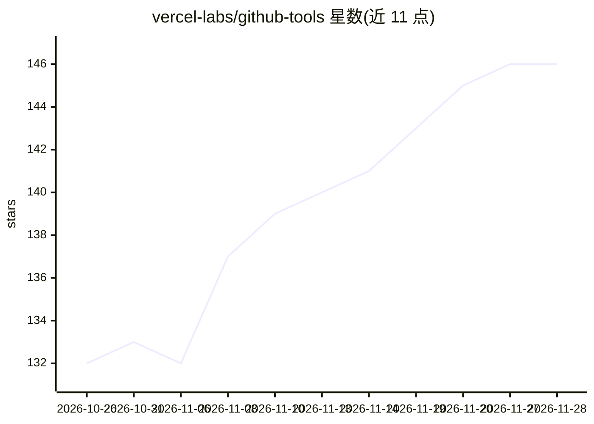

# vercel-labs/github-tools

⭐ 146 · TypeScript · MIT · 推送 2026-11-19 · [GitHub](https://github.com/vercel-labs/github-tools) · [官网](https://github-tools.com) · 组织维护

**给 agent 接入 GitHub API 的 TypeScript 工具层 SDK**

将 GitHub API 封装为 97 个可插拔的 AI SDK 工具，覆盖仓库、PR、issue、release、workflow 等，提供 10 个按任务划分的可组合预设。写操作默认要求人工审批，支持 guardrails 限制调用范围、dryRun 影子模式与含密钥输入的拦截；配合 Vercel Workflow 可实现持久化步骤执行。安装方式为 pnpm/npm 安装 npm 包，ai 与 zod 为 peer dependencies，面向构建 GitHub agent 或机器人的 TypeScript 开发者。

## 筛选速览

| 维度 | 判定 | 备注 |
|---|---|---|
| AI 角色 | `ai-ecosystem` | LLM/agent 周边工具 |
| 许可风险 | `permissive` | MIT |
| 部署形态 | `library` | 以包/库形式分发 |
| 模型依赖 | — | README 未给出锁定关系 |
| 硬件要求 | — | 无带数字的原话,不猜 |
| 安装摩擦 | `low` | 无编译、无系统依赖或容器化 |
| 成熟度 | — | 结构信号不足 |

## 能力要点

- 97 个类型化工具与 10 个内置可组合预设
- 写操作默认人工审批，支持 auto 自动审批低风险写
- guardrails 在请求到达 GitHub 前拦截，含密钥输入默认失败
- dryRun 影子模式可在真实数据上试运行写操作

## 适用场景

- 构建可操作 GitHub 仓库的代码审查或 issue 分诊 agent
- 为 Slack/Discord 的 GitHub 机器人提供工具层
- 在生产环境中以人工审批与 guardrails 控制写操作风险
- 在持久化工作流中让 agent 任务可跨重启恢复

## 场景标签

`代码审查` `Agent 框架` · 领域:Agent 开发

## 证据(README 行号)

> L10: **Give any agent GitHub access.** A typed tool layer for GitHub AI agents, with presets, human approval, and durabl
> L37: 97 tools cover repositories, branches, pull requests, issues, reactions, discussions, notifications, commits, relea
> L92: For an agent that handles open-ended requests, `createGithubAgent({ model, preset: 'auto' })` asks a fast evaluatio

## 星数曲线

2026-10-26 132 → 2026-11-28 146（+14）

---
*卡片 v1 · prompt 1.4 · 生成 2026-11-27 · 置信度 high · 依据 README sha `588678320fa8` · [字段定义](../../DATASET.md)*
