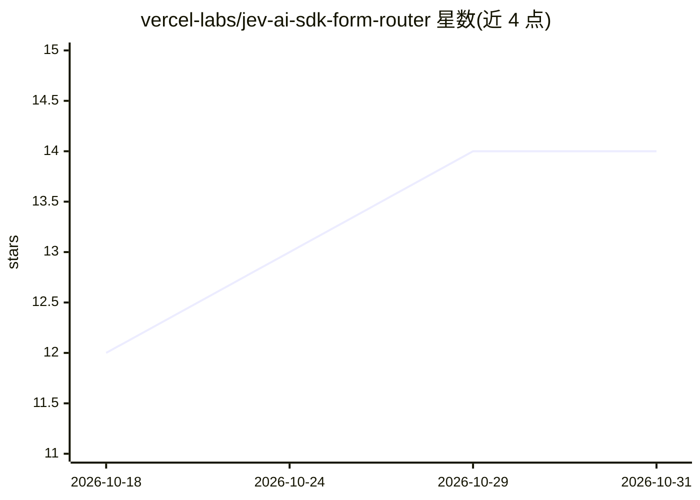

# vercel-labs/jev-ai-sdk-form-router

⭐ 14 · TypeScript · MIT · 推送 2026-09-22 · [GitHub](https://github.com/vercel-labs/jev-ai-sdk-form-router) · [官网](https://vercel.com/kb/guide/jev-ai-sdk-form-router) · 组织维护

**用 Jev+AI SDK 按内容将表单提交路由给对应团队的应用模板**

基于 Next.js 16 与 AI SDK 7 的示例应用：三个表单（线索、联系、问题报告）的提交经 Zod 校验后，由 Jev 通过 experimental_evaluate 评估并选择目标团队；置信度低于 95%、缺失或评估失败时，改由 openai/gpt-6-luna-fast 经 generateText 独立评估并作最终决定。结果含目标、判定模型、统计与邮件预览，可选通过 Resend 发送邮件，提供商调用有超时与一次重试。面向在 Vercel 平台部署的开发者。

## 筛选速览

| 维度 | 判定 | 备注 |
|---|---|---|
| AI 角色 | `ai-native` | 本体是模型或模型工具 |
| 许可风险 | `permissive` | MIT |
| 部署形态 | `library` | 以包/库形式分发 |
| 模型依赖 | — | README 未给出锁定关系 |
| 硬件要求 | — | 无带数字的原话,不猜 |
| 安装摩擦 | `low` | 无编译、无系统依赖或容器化 |
| 成熟度 | — | 结构信号不足 |

## 能力要点

- Jev 评估 + 低于 95% 置信度回退到 openai/gpt-6-luna-fast 的两级路由
- 三种表单分别路由到销售/支持/工程类团队
- 可选 Resend 邮件投递，收件地址仅存服务端
- 测试 mock 模型提供商与 Resend，不做外部调用

## 适用场景

- 把线索、联系或问题报告表单按内容自动分派给对应团队
- 参考其置信度阈值与回退策略实现自己的 AI 路由
- 部署到 Vercel 并接入 AI Gateway 快速体验

## 场景标签

`工作流自动化` · 领域:效率与自动化

## 证据(README 行号)

> L3: Three forms use Jev to route submissions by context, with `openai/gpt-6-luna-fast` handling uncertain or failed eval
> L72: 2. Jev evaluates the complete submission using AI SDK’s `experimental_evaluate` and selects an allowed team/special
> L74: 4. If confidence is lower, missing, or invalid, or Jev fails, `openai/gpt-6-luna-fast` independently evaluates the 

## 星数曲线

2026-10-18 12 → 2026-10-31 14（+2）

---
*卡片 v1 · prompt 1.4 · 生成 2026-10-31 · 置信度 mid · 依据 README sha `e0fcd74be9dc` · [字段定义](../../DATASET.md)*
