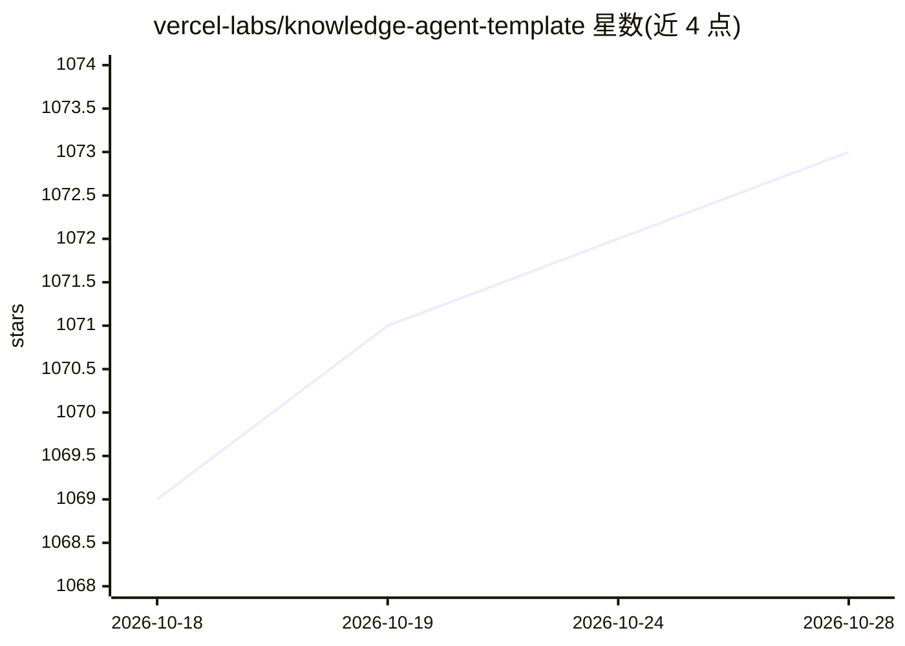

# vercel-labs/knowledge-agent-template

⭐ 1,073 · TypeScript · MIT · 推送 2026-09-15 · [GitHub](https://github.com/vercel-labs/knowledge-agent-template) · [官网](https://chatsdk-knowledge-agent.vercel.app) · 组织维护

**文件系统检索式知识库 AI agent 模板，可部署为聊天/机器人应用**

开源的基于文件系统的知识库 agent 模板：将 GitHub 仓库、YouTube 字幕、自定义 API 等来源同步到快照仓库，agent 在隔离沙箱中用 grep/find/cat 做确定性检索，不使用嵌入与向量数据库。提供复杂度路由（按问题难度分流模型）、管理后台、管理 agent、沙箱池（共享只读命令策略）与多平台机器人适配器（GitHub/Discord）。基于 Nuxt 与 Vercel AI SDK，支持一键部署到 Vercel 或 git clone 自托管，需配置多个环境变量。

## 筛选速览

| 维度 | 判定 | 备注 |
|---|---|---|
| AI 角色 | `ai-ecosystem` | LLM/agent 周边工具 |
| 许可风险 | `permissive` | MIT |
| 部署形态 | `None` |  |
| 模型依赖 | — | README 未给出锁定关系 |
| 硬件要求 | — | 无带数字的原话,不猜 |
| 安装摩擦 | `low` | 无编译、无系统依赖或容器化 |
| 成熟度 | — | 结构信号不足 |

## 能力要点

- 沙箱内 grep/find/cat 文件检索，无向量数据库与嵌入管线
- 复杂度路由自动将问题分流到不同成本的模型
- 共享沙箱池，只读命令策略，启动低于 100ms
- 内置管理后台与管理 agent（query_stats/run_sql/chart 等内部工具）
- 一套 agent 可部署为 Web 聊天、GitHub 机器人、Discord 机器人

## 适用场景

- 基于自己的仓库和视频字幕搭建可对话的知识问答应用
- 把同一个知识 agent 同时接入 GitHub Issues 和 Discord
- 自托管一个可观测（工具调用可视化、用量统计）的团队知识机器人

## 场景标签

`聊天机器人` `文档问答` · 领域:对话与助手

## 证据(README 行号)

> L7:  Template. Fork it, customize it, and deploy your own file-system based AI agent.
> L11: Open source file-system and knowledge based agent template. Build AI agents that stay up to date with your knowledg
> L61: |`@savoir/agent`|Agent core: router, prompts, tools, types|

## 星数曲线

2026-10-18 1,069 → 2026-10-28 1,073（+4）

---
*卡片 v1 · prompt 1.4 · 生成 2026-10-21 · 置信度 high · 依据 README sha `ea9864c0401c` · [字段定义](../../DATASET.md)*
