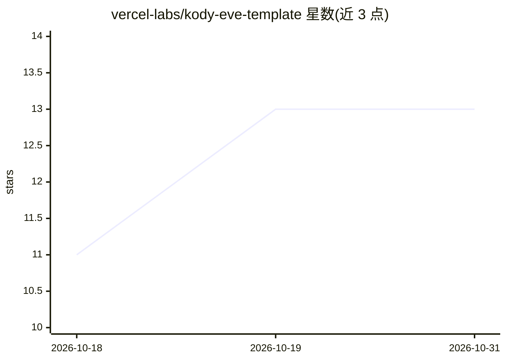

# vercel-labs/kody-eve-template

⭐ 13 · TypeScript · MIT · 推送 2026-10-23 · [GitHub](https://github.com/vercel-labs/kody-eve-template) · [官网](https://vercel.com/templates/eve/eve-github-maintainer) · 组织维护

**基于 eve 框架的个人 GitHub 维护 agent 模板，邮件驱动处理 issue**

Kody 是构建在 eve agent 框架上的 GitHub 维护 agent 模板，面向自由职业者与单人维护者。每周通过 cron 拉取仓库开放 issue 生成分组摘要，经 Resend 邮件发送；用户直接回复邮件即可下达指令（评论、打标签、关闭 issue、创建 Linear issue）。此外持续总结新 PR、回复 GitHub @提及、在 Linear Agent Sessions 中处理委派任务，偏好存储于 Vercel Blob。技术栈为 TypeScript，通过 Vercel 一键部署，需配置 GitHub/Linear 连接器、Resend、Redis 等外部服务。

## 筛选速览

| 维度 | 判定 | 备注 |
|---|---|---|
| AI 角色 | `ai-native` | 本体是模型或模型工具 |
| 许可风险 | `permissive` | MIT |
| 部署形态 | `None` |  |
| 模型依赖 | — | README 未给出锁定关系 |
| 硬件要求 | — | 无带数字的原话,不猜 |
| 安装摩擦 | `low` | 无编译、无系统依赖或容器化 |
| 成熟度 | — | 结构信号不足 |

## 能力要点

- 每周 cron 拉取开放 issue 生成分组邮件摘要（Resend 发送）
- 回复邮件即执行 GitHub/Linear 操作，全程留在收件箱
- 自动总结新 PR 并跳过 bot 创建的 PR
- 偏好存储于 Vercel Blob，支持 eve 远程子 agent 委派

## 适用场景

- 单人维护者每周邮件了解仓库 issue 状态并回复处理
- 自动为新 PR 生成导览式总结评论
- 在 Linear 中委派任务给 agent 协同处理 issue

## 场景标签

 · 领域:开发工具/Agent 应用

## 证据(README 行号)

> L6: Kody is a personal GitHub maintainer agent built on eve, made for freelancers, solo maintainers, and anyone who runs
> L58: |Agent framework|eve|

## 星数曲线

2026-10-18 11 → 2026-10-31 13（+2）

---
*卡片 v1 · prompt 1.4 · 生成 2026-10-31 · 置信度 high · 依据 README sha `b149e98ff255` · [字段定义](../../DATASET.md)*
