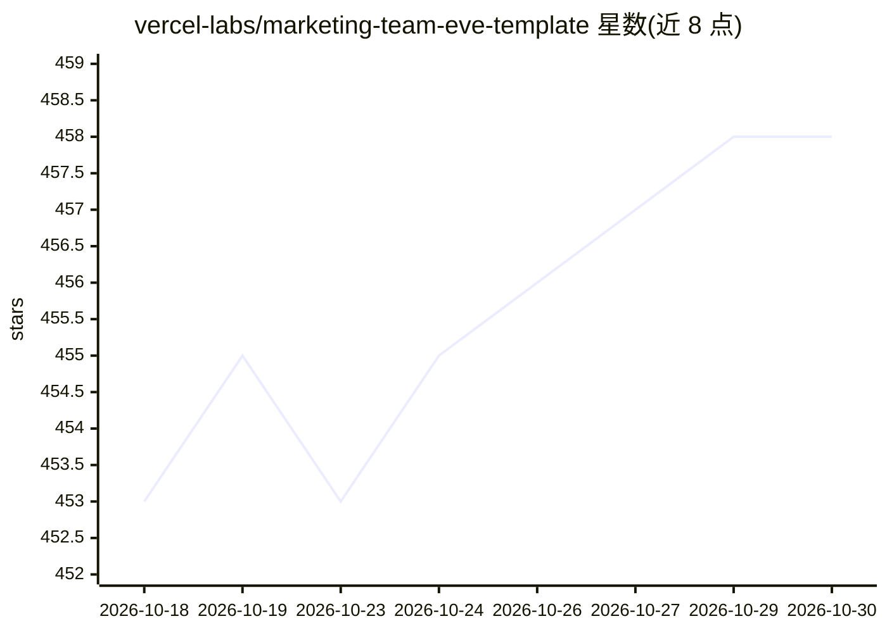

# vercel-labs/marketing-team-eve-template

⭐ 458 · TypeScript · MIT · 推送 2026-10-23 · [GitHub](https://github.com/vercel-labs/marketing-team-eve-template) · [官网](https://vercel.com/templates/eve/eve-marketing-team) · 组织维护

**基于 eve 的营销 Agent 团队模板，产出博客/社媒/邮件内容**

vercel-labs 提供的营销 Agent 团队模板：一个 lead 负责理解任务、撰写简报并分派给 product-marketer、content-marketer、social-media-coordinator、seo、email 五个专家，产出落在用户既有工具中——Notion 长文、Typefully 社媒草稿、Resend 邮件活动。共享状态为单一 brand context 文档；发送邮件、定时发布等不可逆操作需用户在 Slack 或终端审批。通过 Vercel 一键部署，经 Slack 或 TUI 交互，模型经 Vercel AI Gateway 访问。

## 筛选速览

| 维度 | 判定 | 备注 |
|---|---|---|
| AI 角色 | `ai-native` | 本体是模型或模型工具 |
| 许可风险 | `permissive` | MIT |
| 部署形态 | `library` | 以包/库形式分发 |
| 模型依赖 | — | README 未给出锁定关系 |
| 硬件要求 | — | 无带数字的原话,不猜 |
| 安装摩擦 | `low` | 无编译、无系统依赖或容器化 |
| 成熟度 | — | 结构信号不足 |

## 能力要点

- 一 lead + 五专家的委派结构，brief 自包含、委派仅一层
- 产出直接交付到 Notion / Typefully / Resend 等既有工具
- 不可逆操作（发送/定时发布/删除）设人工审批门
- 支持 remote agents，专家可独立部署与发布

## 适用场景

- 让 Agent 团队起草产品发布的社媒帖与公告文案
- 自动化长文内容写作并落到 Notion
- 策划并在审批后发送 Resend 邮件活动
- 对落地页做 SEO 审计

## 场景标签

`AI 写作` `多智能体` · 领域:Agent 开发

## 证据(README 行号)

> L8: Run a team of marketing agents built on eve. You bring work to a team lead: a launch to plan, posts to write, or a p
> L10: You talk to it in Slack or a terminal. It delivers real work in the tools you already use: blog drafts in Notion, s

## 星数曲线

2026-10-18 453 → 2026-10-30 458（+5）

---
*卡片 v1 · prompt 1.4 · 生成 2026-10-21 · 置信度 mid · 依据 README sha `6b3b232d0445` · [字段定义](../../DATASET.md)*
