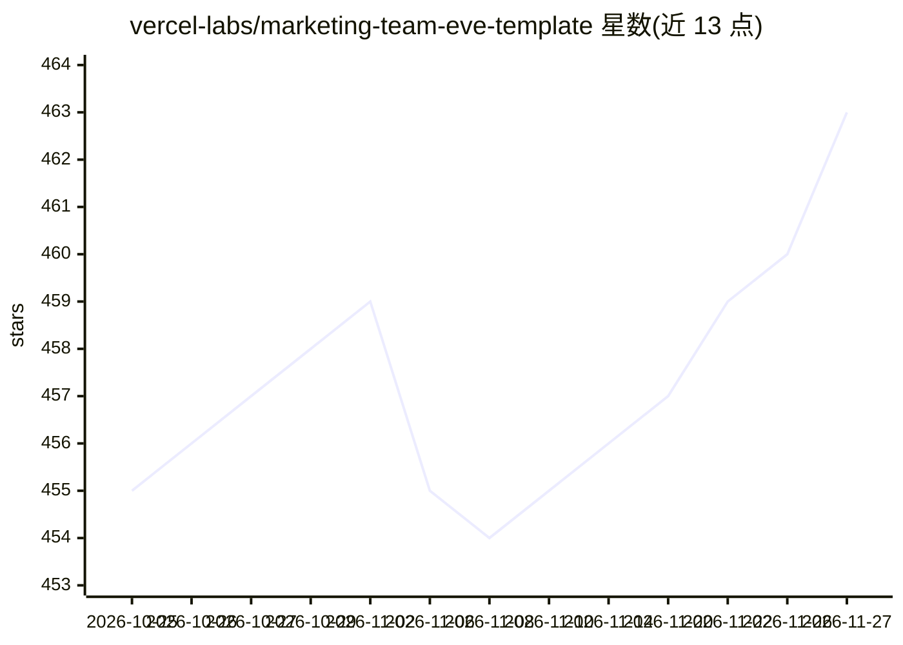

# vercel-labs/marketing-team-eve-template

⭐ 463 · TypeScript · MIT · 推送 2026-11-25 · [GitHub](https://github.com/vercel-labs/marketing-team-eve-template) · [官网](https://vercel.com/templates/eve/eve-marketing-team) · 组织维护

**基于 eve 框架的营销 agent 团队模板，经 Slack/终端交付**

Vercel Labs 发布的模板仓库：在 eve agent 框架之上搭建一个营销 agent 团队（1 个 lead + 5 个专员，覆盖定位、长文、社媒、SEO、邮件）。用户通过 Slack 或终端与 lead 对话，专员产出落在 Notion、Typefully、Resend 等既有工具中。机制上：brief 自包含、委派仅一层、所有不可逆操作（发送/删除/发布）须经 Slack 或终端审批；认证走 Vercel Connect 与 OIDC。部署依赖 Vercel 平台与 Notion/Resend/Slack 账号。

## 筛选速览

| 维度 | 判定 | 备注 |
|---|---|---|
| AI 角色 | `ai-native` | 本体是模型或模型工具 |
| 许可风险 | `permissive` | MIT |
| 部署形态 | `library` | 以包/库形式分发 |
| 模型依赖 | — | README 未给出锁定关系 |
| 硬件要求 | — | 无带数字的原话,不猜 |
| 安装摩擦 | `low` | 无编译、无系统依赖或容器化 |
| 成熟度 | — | 结构信号不足 |

## 能力要点

- 1 个 lead + 5 个专员的角色分工与共享品牌上下文文档
- 不可逆操作审批门：发送邮件、定时发布、页面编辑均需确认
- 通过 Notion/Typefully/Resend 的 MCP 连接交付实际产出
- 提供离线 evals（mock 模型）与在线 evals 测试套件

## 适用场景

- 让 agent 团队起草产品发布公告并进入 Typefully 队列待审
- 为新页面做 SEO 审计并获得 JSON-LD 建议内容
- 把 newsletter 从撰写到 Resend 发送走完双专员流程
- 在 eve 框架上定制自己的多专员 agent 团队

## 场景标签

`多智能体` `AI 写作` · 领域:Agent 开发

## 证据(README 行号)

> L6: Run a team of marketing agents built on eve, the open-source agent framework. You bring work to a team lead: a launc
> L8: You talk to it in Slack or a terminal. It delivers real work in the tools you already use: blog drafts in Notion, so
> L80: |Agent framework|eve|

## 星数曲线

2026-10-25 455 → 2026-11-27 463（+8）

---
*卡片 v1 · prompt 1.4 · 生成 2026-11-25 · 置信度 mid · 依据 README sha `59e9ed77f72d` · [字段定义](../../DATASET.md)*
