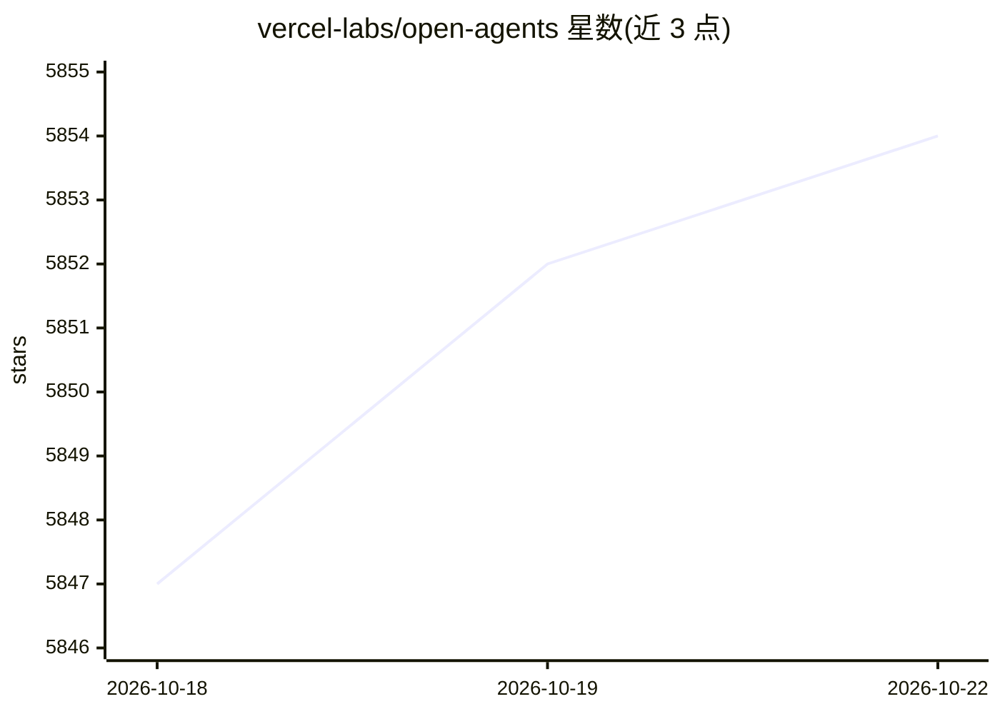

# vercel-labs/open-agents

⭐ 5,854 · TypeScript · MIT · 推送 2026-08-29 · [GitHub](https://github.com/vercel-labs/open-agents) · [官网](https://open-agents.dev) · 组织维护

**在 Vercel 上构建后台编码 agent 的开源参考应用模板**

三层架构（Web → agent workflow → 沙箱 VM）的参考应用：Web 层负责认证、会话与流式聊天 UI，agent 以 Vercel Workflow SDK 持久化工作流运行（可断点恢复），沙箱提供文件系统、shell、git 与预览端口；agent 与沙箱分离运行，通过工具调用交互。支持仓库克隆、自动 commit/push/PR 创建、会话只读分享，可选 ElevenLabs 语音转录。面向开发者 fork 后自行部署与改造，需配置 Vercel OAuth、GitHub App 等环境变量。

## 筛选速览

| 维度 | 判定 | 备注 |
|---|---|---|
| AI 角色 | `ai-ecosystem` | LLM/agent 周边工具 |
| 许可风险 | `permissive` | MIT |
| 部署形态 | `library` | 以包/库形式分发 |
| 模型依赖 | — | README 未给出锁定关系 |
| 硬件要求 | — | 无带数字的原话,不猜 |
| 安装摩擦 | `low` | 无编译、无系统依赖或容器化 |
| 成熟度 | — | 结构信号不足 |

## 能力要点

- agent 与沙箱分离：agent 在 VM 外通过工具（文件/搜索/shell）操作执行环境
- Workflow SDK 支撑的多步持久化执行，支持流式、取消与重连恢复
- 沙箱支持快照恢复、闲置休眠、克隆仓库与分支作业
- 成功运行后可选自动 commit、push 与 PR 创建

## 适用场景

- 部署一个自己的云端后台编码 agent，从对话直接产出代码变更
- fork 并改造该模板，构建自定义 agent 应用
- 研究 agent-沙箱分离架构的参考实现

## 场景标签

`编码 Agent` `Agent 框架` · 领域:Agent 开发

## 证据(README 行号)

> L5: Open Agents is an open-source reference app for building and running background coding agents on Vercel. It includes
> L7: The repo is meant to be forked and adapted, not treated as a black box.
> L18: - The agent runs as a durable workflow on Vercel.

## 星数曲线

2026-10-18 5,847 → 2026-10-22 5,854（+7）

---
*卡片 v1 · prompt 1.4 · 生成 2026-10-20 · 置信度 high · 依据 README sha `8ba549eb372c` · [字段定义](../../DATASET.md)*
