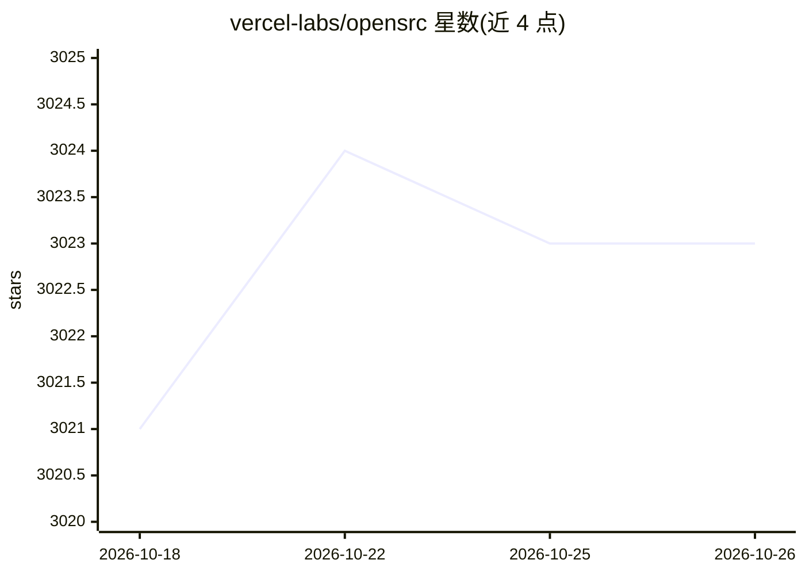

# vercel-labs/opensrc

⭐ 3,023 · Rust · Apache-2.0 · 推送 2026-09-16 · [GitHub](https://github.com/vercel-labs/opensrc) · [官网](https://opensrc.sh) · 组织维护

**给 AI 编码 agent 提供包源码获取与缓存上下文的 CLI**

Vercel Labs 实验项目：CLI 工具 opensrc，从 npm、PyPI、crates.io 和 GitHub 拉取包的源码并本地缓存，供 AI 编码 agent（如配合 rg 检索）获取依赖包的真实实现作为上下文。首次使用时抓取，之后返回缓存路径。CLI 用 Rust 编写（cargo 构建），monorepo 采用 Turborepo + pnpm，文档站为 Next.js。通过 npm 全局安装。

## 筛选速览

| 维度 | 判定 | 备注 |
|---|---|---|
| AI 角色 | `ai-ecosystem` | LLM/agent 周边工具 |
| 许可风险 | `permissive` | Apache-2.0 |
| 部署形态 | `library` | 以包/库形式分发 |
| 模型依赖 | — | README 未给出锁定关系 |
| 硬件要求 | — | 无带数字的原话,不猜 |
| 安装摩擦 | `low` | 无编译、无系统依赖或容器化 |
| 成熟度 | — | 结构信号不足 |

## 能力要点

- 从 npm/PyPI/crates.io/GitHub 拉取包源码
- 首次抓取后缓存路径即时返回
- Rust 实现的 CLI，npm 全局安装

## 适用场景

- 让编码 agent 读取依赖库源码以获得更深上下文
- 在本地检索任意包的实现细节

## 场景标签

 · 领域:开发者工具/AI 编码

## 证据(README 行号)

> L8: Give coding agents access to any package's source code.
> L29: |`opensrc`|CLI — fetch and cache source code from npm, PyPI, crates.io, and GitHub|

## 星数曲线

2026-10-18 3,021 → 2026-10-26 3,023（+2）

---
*卡片 v1 · prompt 1.4 · 生成 2026-10-20 · 置信度 mid · 依据 README sha `9718ecadf687` · [字段定义](../../DATASET.md)*
