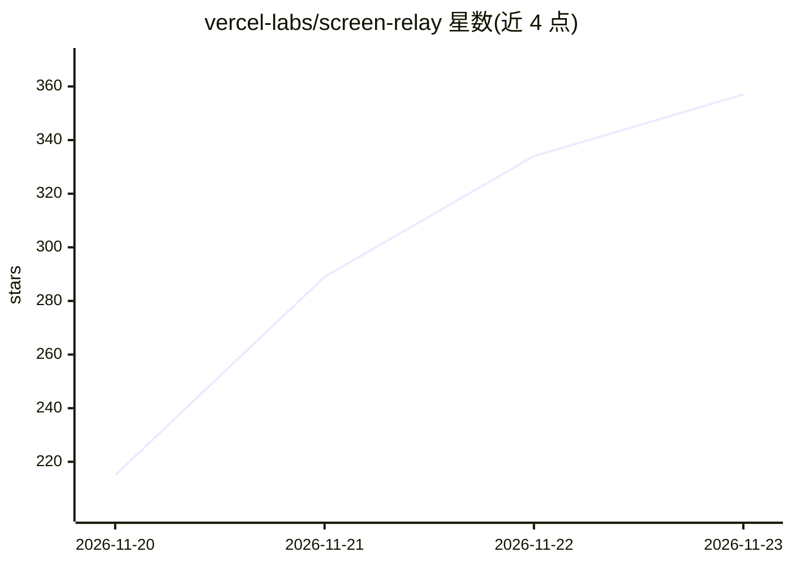

# vercel-labs/screen-relay

⭐ 357 · C++ · Apache-2.0 · 推送 2026-11-22 · [GitHub](https://github.com/vercel-labs/screen-relay) · [官网](https://screen-relay.dev) · 组织维护

**给人类和 AI agent 用的低延迟桌面串流与控制工具**

screen-relay 在 Linux VM/沙箱/容器内启动桌面，或接入 Mac 显示器与 Windows 登录桌面，将画面以 H.264 串流到浏览器。人类通过浏览器观看，AI agent 通过 CLI/Node SDK/HTTP 与 WebSocket API 逐条下发命令：截图、点击、键入、再截图验证结果。引擎单端口提供查看器、流与输入 API，链路慢时自动降低码率，带输入权转移与令牌保护。由 Vercel Labs 以实验项目形式发布，Apache-2.0 许可。

## 筛选速览

| 维度 | 判定 | 备注 |
|---|---|---|
| AI 角色 | `ai-enhanced` | 去掉 AI 部分产品仍成立 |
| 许可风险 | `permissive` | Apache-2.0 |
| 部署形态 | `library` | 以包/库形式分发 |
| 模型依赖 | — | README 未给出锁定关系 |
| 硬件要求 | — | 无带数字的原话,不猜 |
| 安装摩擦 | `medium` | 含编译或系统依赖之一 |
| 成熟度 | `idea` | |

## 能力要点

- CLI、Node SDK 与 HTTP/WebSocket API 访问同一会话
- 随版本内置 agent skills（screen-relay skills get core）
- 支持 X11/Wayland、Linux/macOS/Windows 三平台
- 默认仅监听 loopback，远程访问需令牌

## 适用场景

- 让 AI agent 操控桌面并截图验证执行结果
- 在浏览器中远程观看 VM 或容器内的桌面
- 通过 shell 对远端桌面执行点击、键入等操作

## 场景标签

`GUI 自动化` · 领域:效率与自动化

## 证据(README 行号)

> L3: Desktop streaming and control for humans and AI agents: watch a desktop in a browser, and click, type, and take scre
> L9: screen-relay starts a desktop on a Linux VM, sandbox, or container, or attaches to the display of a Mac or the signe

## 星数曲线

2026-11-20 215 → 2026-11-23 357（+142）

---
*卡片 v1 · prompt 1.4 · 生成 2026-11-20 · 置信度 high · 依据 README sha `eb57030639ea` · [字段定义](../../DATASET.md)*
