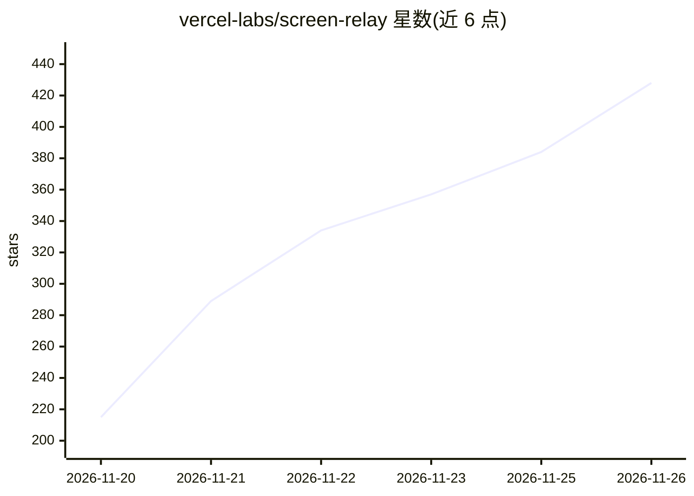

# vercel-labs/screen-relay

⭐ 428 · C++ · Apache-2.0 · 推送 2026-11-25 · [GitHub](https://github.com/vercel-labs/screen-relay) · [官网](https://screen-relay.dev) · 组织维护

**供人类与 AI agent 观看并控制桌面的低延迟流式工具**

screen-relay 在 Linux VM/沙箱/容器中启动桌面，或接入 macOS/Windows 已登录桌面，以 H.264 流式传输到浏览器；同一会话可通过 CLI、Node SDK、HTTP/WebSocket API 由 agent 逐步执行截图、点击、输入等操作。引擎在用户机器上由 screen-relay install 构建，要求 Node 22+；支持 X11 与 Wayland 后端，慢链路自动降低码率，本地默认监听 loopback，远程需 token。

## 筛选速览

| 维度 | 判定 | 备注 |
|---|---|---|
| AI 角色 | `ai-ecosystem` | LLM/agent 周边工具 |
| 许可风险 | `permissive` | Apache-2.0 |
| 部署形态 | `library` | 以包/库形式分发 |
| 模型依赖 | — | README 未给出锁定关系 |
| 硬件要求 | — | 无带数字的原话,不猜 |
| 安装摩擦 | `medium` | 含编译或系统依赖之一 |
| 成熟度 | `idea` | |

## 能力要点

- CLI/Node SDK/HTTP+WebSocket API 三种方式访问同一会话
- 附带与版本匹配的 agent skills，供 AI agent 引用控制流程
- 支持 X11/Wayland 后端，覆盖 Linux/macOS/Windows
- 单输入所有者机制与 token 鉴权

## 适用场景

- 在浏览器中远程观看沙箱或 VM 里的桌面
- 让 AI agent 通过截图-操作-再截图的循环控制桌面
- 对另一台机器的桌面会话做截图与键鼠操作

## 场景标签

`GUI 自动化` · 领域:效率与自动化

## 证据(README 行号)

> L3: Desktop streaming and control for humans and AI agents: watch a desktop in a browser, and click, type, and take scre
> L9: screen-relay starts a desktop on a Linux VM, sandbox, or container, or attaches to the display of a Mac or the signe
> L49: The CLI ships skills that match its version:

## 星数曲线

2026-11-20 215 → 2026-11-26 428（+213）

---
*卡片 v1 · prompt 1.4 · 生成 2026-11-25 · 置信度 high · 依据 README sha `d9930a5a8175` · [字段定义](../../DATASET.md)*
