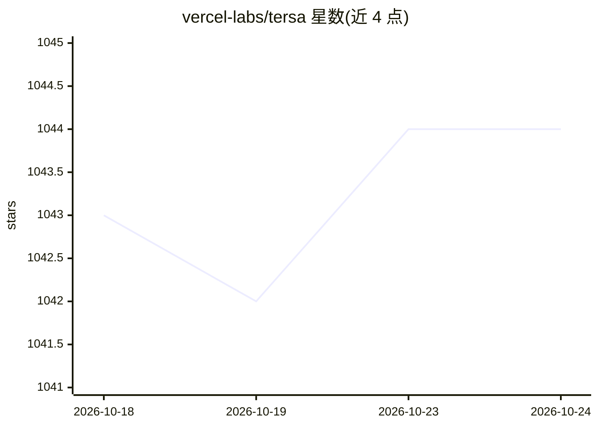

# vercel-labs/tersa

⭐ 1,043 · TypeScript · MIT · 推送 2026-05-01 · [GitHub](https://github.com/vercel-labs/tersa) · [官网](https://tersa-phi.vercel.app) · 组织维护

**可视化拖拽画布，用于搭建和运行 AI 工作流**

基于 Next.js 15 与 React 19 的开源 Web 应用：在拖拽画布上添加节点、连线并运行，构建由 AI 模型驱动的处理流程。通过 Vercel AI SDK Gateway 接入 25+ 提供商的文本、图像和视频模型，支持流式响应、查看模型推理过程、跨模型成本指示；画布状态自动保存在浏览器本地存储，媒体存储使用 Vercel Blob。安装方式为 git clone 源码后 pnpm 安装依赖并运行开发服务器，需配置 AI SDK Gateway 凭证及各提供商 API key。

## 筛选速览

| 维度 | 判定 | 备注 |
|---|---|---|
| AI 角色 | `ai-ecosystem` | LLM/agent 周边工具 |
| 许可风险 | `permissive` | MIT |
| 部署形态 | `library` | 以包/库形式分发 |
| 模型依赖 | — | README 未给出锁定关系 |
| 硬件要求 | — | 无带数字的原话,不猜 |
| 安装摩擦 | `low` | 无编译、无系统依赖或容器化 |
| 成熟度 | — | 结构信号不足 |

## 能力要点

- 拖拽画布式工作流构建器（ReactFlow）
- 经 Vercel AI SDK Gateway 接入 25+ 提供商的文本/图像/视频模型
- 流式响应与模型推理过程展示
- 画布状态本地持久化与跨模型成本指示

## 适用场景

- 在浏览器中拖拽搭建多模型 AI 处理流程
- 对比不同模型并查看流式输出与推理过程
- 无需写代码快速试验 AI 工作流组合

## 场景标签

`工作流自动化` · 领域:效率与自动化

## 证据(README 行号)

> L5: A visual AI playground. Drag, drop, connect and run nodes to build AI workflows powered by the Vercel AI SDK Gateway
> L10: - **Multi-Model Support**: Access text, image and video models from 25+ providers through Vercel AI SDK Gateway
> L20: - Vercel AI SDK with AI SDK Gateway

## 星数曲线

2026-10-18 1,043 → 2026-10-24 1,044（+1）

---
*卡片 v1 · prompt 1.4 · 生成 2026-10-21 · 置信度 mid · 依据 README sha `16f62274c641` · [字段定义](../../DATASET.md)*
