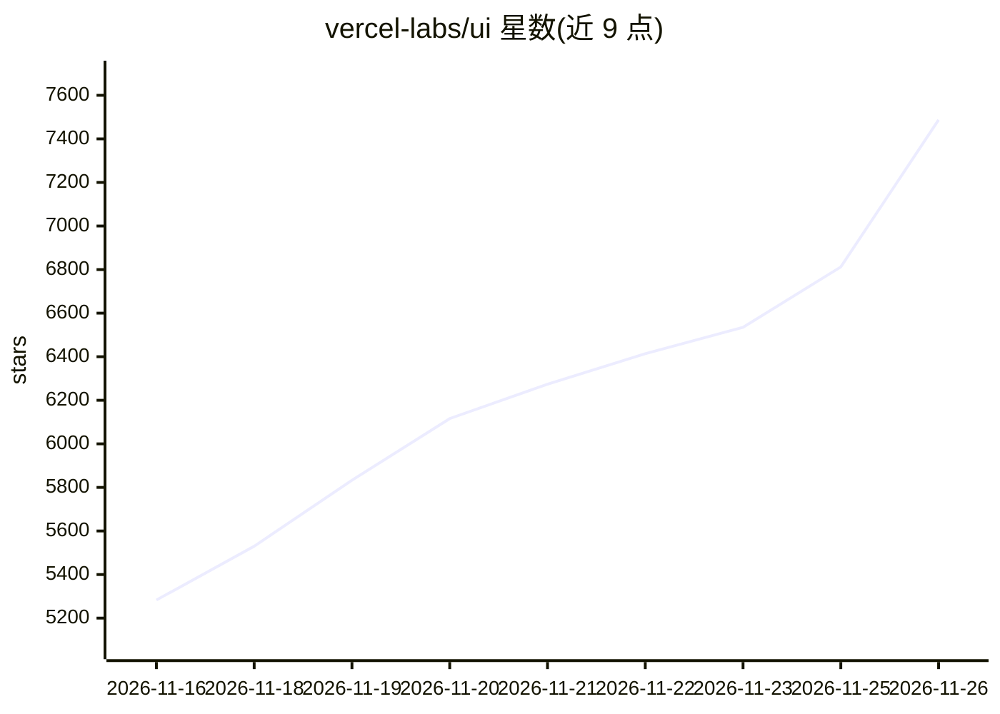

# vercel-labs/ui

⭐ 7,487 · TypeScript · Apache-2.0 · 推送 2026-11-25 · [GitHub](https://github.com/vercel-labs/ui) · [官网](https://ui-sdk.dev) · 组织维护

**供 agent 驱动构建交互 UI 的行为库（headless SDK）**

Vercel 出品的 UI SDK（beta）：将键盘导航、焦点、选择、弹层、拖放及所需 ARIA 封装为 @ui-sdk/core 中的行为（behaviors），并提供 React、Vue、Svelte、Solid、Web Components 五种适配器。组件由 createPopup、createSelection、createTypeahead 等行为组合成 primitive，再用 createParts 在各框架渲染相同部件。面向使用 agent 的开发者，通过 npx skills 为 agent 安装 ui-sdk 技能，由 agent 编写行为组合代码；当前处于 beta，API 与行为可能变更。

## 筛选速览

| 维度 | 判定 | 备注 |
|---|---|---|
| AI 角色 | `ai-ecosystem` | LLM/agent 周边工具 |
| 许可风险 | `permissive` | Apache-2.0 |
| 部署形态 | `library` | 以包/库形式分发 |
| 模型依赖 | — | README 未给出锁定关系 |
| 硬件要求 | — | 无带数字的原话,不猜 |
| 安装摩擦 | `low` | 无编译、无系统依赖或容器化 |
| 成熟度 | `idea` | |

## 能力要点

- 核心行为（焦点恢复、选择、弹层、拖放等）与 ARIA 封装于 @ui-sdk/core
- 同一 primitive 输出 React/Vue/Svelte/Solid/Web Components 五种适配器部件
- 通过 npx skills@latest add 安装 ui-sdk 技能供 agent 使用
- npm 安装，处于 beta 阶段并受 Vercel beta 条款约束

## 适用场景

- 让 agent 生成符合 ARIA 无障碍要求的交互组件
- 在多框架项目中复用同一套 headless 行为定义
- 构建搜索框、弹层、类型提示等含键盘导航的部件

## 场景标签

`代码生成` · 领域:编码与开发

## 证据(README 行号)

> L3: A library of behaviors for agents to build and drive the next generation of user interfaces.
> L5: Keyboard navigation, focus, selection, dismissal, popups, drag and drop and the ARIA they need live in `@ui-sdk/core
> L21: Then give your agent the UI SDK skill:

## 星数曲线

2026-11-16 5,283 → 2026-11-26 7,487（+2,204）

---
*卡片 v1 · prompt 1.4 · 生成 2026-11-24 · 置信度 high · 依据 README sha `50f4807977c0` · [字段定义](../../DATASET.md)*
