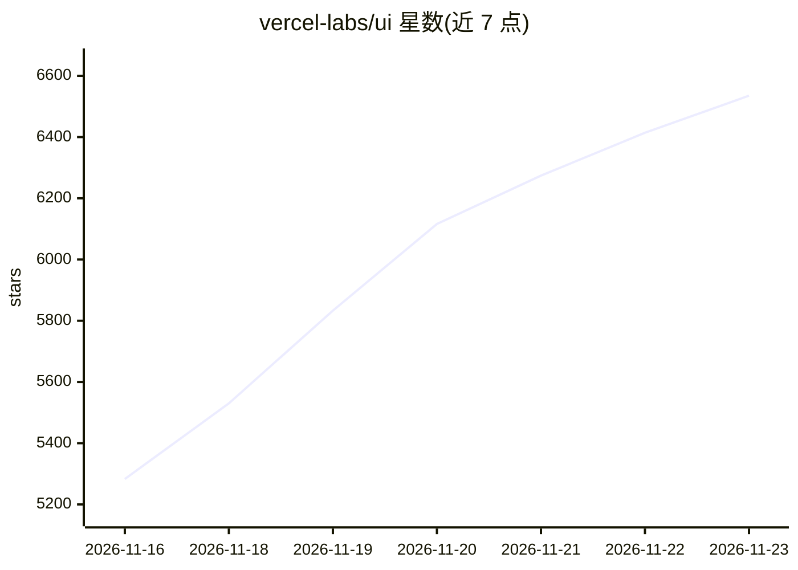

# vercel-labs/ui

⭐ 6,535 · TypeScript · Apache-2.0 · 推送 2026-11-22 · [GitHub](https://github.com/vercel-labs/ui) · [官网](https://ui-sdk.dev) · 组织维护

**面向 agent 的无头 UI 行为库，覆盖五大前端框架**

UI SDK 提供键盘导航、焦点、选择、弹层、拖放及对应 ARIA 行为的 headless 原语（@ui-sdk/core），并为 React、Vue、Svelte、Solid 和 Web Components 提供适配层。其设计面向 AI agent 构建界面：开发者通过 npm 安装核心与框架适配包后，可用 npx skills 命令为 agent 注入 UI SDK 技能，由 agent 组合行为生成组件。README 声明处于 beta 阶段，API 与行为可能在正式版前变化。

## 筛选速览

| 维度 | 判定 | 备注 |
|---|---|---|
| AI 角色 | `ai-enhanced` | 去掉 AI 部分产品仍成立 |
| 许可风险 | `permissive` | Apache-2.0 |
| 部署形态 | `library` | 以包/库形式分发 |
| 模型依赖 | — | README 未给出锁定关系 |
| 硬件要求 | — | 无带数字的原话,不猜 |
| 安装摩擦 | `low` | 无编译、无系统依赖或容器化 |
| 成熟度 | `idea` | |

## 能力要点

- 核心包提供键盘导航、焦点、选择、弹层、拖放等行为及 ARIA 支持
- 五个框架适配：React/Vue/Svelte/Solid/Web Components
- 通过 npx skills 命令为 agent 注入 UI SDK 技能
- 声明处于 beta 阶段，API 可能变更

## 适用场景

- 让 AI agent 生成带无障碍行为的界面组件
- 在多框架项目中复用同一套 headless 交互行为
- 为 agent 构建的前端界面提供键盘与焦点管理

## 场景标签

`代码生成` · 领域:编码与开发

## 证据(README 行号)

> L3: A library of behaviors for agents to build the next generation of user interfaces.
> L5: Keyboard navigation, focus, selection, dismissal, popups, drag and drop and the ARIA they need live in `@ui-sdk/core
> L21: Then give your agent the UI SDK skill:

## 星数曲线

2026-11-16 5,283 → 2026-11-23 6,535（+1,252）

---
*卡片 v1 · prompt 1.4 · 生成 2026-11-17 · 置信度 high · 依据 README sha `7ee9c712ba40` · [字段定义](../../DATASET.md)*
