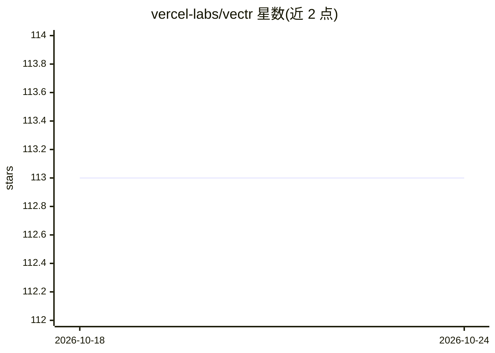

# vercel-labs/vectr

⭐ 113 · TypeScript · MIT · 推送 2026-07-06 · [GitHub](https://github.com/vercel-labs/vectr) · [官网](https://vectr.store/) · 组织维护

**自然语言图片语义搜索的开源应用模板（Vercel 部署）**

基于 Next.js 15 构建的图片搜索应用模板：拖拽上传图片存入 Vercel Blob Storage，经 Grok 2 Vision 生成图片描述，连同元数据索引到 Upstash Vector Search，实现语义搜索。处理流程拆为上传、生成描述、索引三个 serverless 步骤，各带限速重试与致命错误分类（Vercel Workflow，标注为 alpha）。无需数据库。支持 Vercel Marketplace 一键部署，或本地以 pnpm 运行，需配置 Upstash、Vercel Blob 与 xAI 密钥。

## 筛选速览

| 维度 | 判定 | 备注 |
|---|---|---|
| AI 角色 | `ai-native` | 本体是模型或模型工具 |
| 许可风险 | `permissive` | MIT |
| 部署形态 | `library` | 以包/库形式分发 |
| 模型依赖 | locked-api |  |
| 硬件要求 | — | 无带数字的原话,不猜 |
| 安装摩擦 | `low` | 无编译、无系统依赖或容器化 |
| 成熟度 | `idea` | |

## 能力要点

- 上传图片经 Grok 2 Vision 自动生成描述并索引
- Upstash Vector Search 语义搜索并存储元数据，无需数据库
- 三步 serverless 工作流，区分可重试错误与致命错误
- Vercel Marketplace 一键部署，自动配置所需服务

## 适用场景

- 搭建自己的以文搜图/语义图片搜索站点
- 学习 Vercel Workflow 与多服务编排的图片处理管线
- 在免费额度内快速上线一个图片检索应用

## 场景标签

 · 领域:Web 应用/AI 图片搜索

## 证据(README 行号)

> L3: **Vectr** is an AI-powered image search application template that automatically generates descriptions for uploaded 
> L8: - 🤖 **AI-powered image descriptions** using Grok 2 Vision
> L19: 2. 🧠 Generates a detailed description using Grok 2 Vision AI

## 星数曲线

2026-10-18 113 → 2026-10-24 113（+0）

---
*卡片 v1 · prompt 1.4 · 生成 2026-10-23 · 置信度 mid · 依据 README sha `ebd285122629` · [字段定义](../../DATASET.md)*
