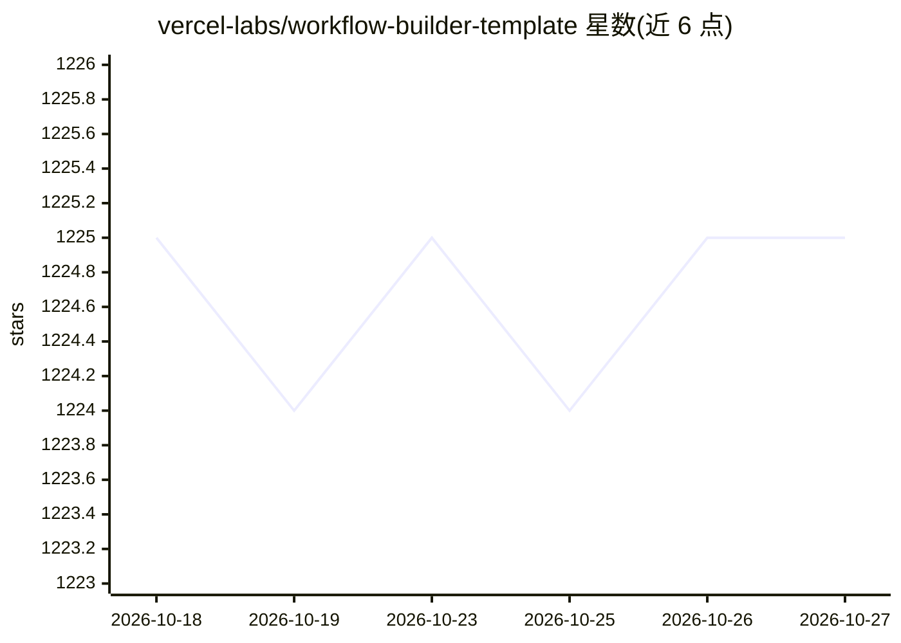

# vercel-labs/workflow-builder-template

⭐ 1,225 · TypeScript · NOASSERTION · 推送 2026-08-05 · [GitHub](https://github.com/vercel-labs/workflow-builder-template) · [官网](https://workflow-builder.dev) · 组织维护

**可视化 AI 工作流自动化平台模板：拖拽搭建流程并生成代码**

基于 Workflow DevKit 的 Next.js 模板，提供拖拽式可视化工作流构建器，节点覆盖 Webhook/定时/数据库事件触发与 AI Gateway、fal.ai、GitHub、Slack、Stripe 等 15 类操作。工作流可通过 'use workflow' 指令转换为可执行 TypeScript 代码，支持自然语言生成工作流（OpenAI）、执行追踪与日志、Better Auth 认证和 Drizzle ORM/PostgreSQL 持久化。可一键部署到 Vercel（自动创建 Neon 数据库），面向开发者构建自己的工作流自动化平台。

## 筛选速览

| 维度 | 判定 | 备注 |
|---|---|---|
| AI 角色 | `ai-ecosystem` | LLM/agent 周边工具 |
| 许可风险 | `none` | NOASSERTION |
| 部署形态 | `library` | 以包/库形式分发 |
| 模型依赖 | — | README 未给出锁定关系 |
| 硬件要求 | — | 无带数字的原话,不猜 |
| 安装摩擦 | `low` | 无编译、无系统依赖或容器化 |
| 成熟度 | — | 结构信号不足 |

## 能力要点

- React Flow 拖拽式可视化工作流构建器
- 工作流转换为带 'use workflow' 指令的可执行 TypeScript 代码
- 自然语言生成工作流（OpenAI）
- 15 类集成节点：AI Gateway、fal.ai、Firecrawl、GitHub、Linear、Slack、Stripe 等

## 适用场景

- 搭建自己的 AI 工作流自动化平台起点
- 用自然语言生成自动化流程再转为 TypeScript 代码
- 连接邮件、工单、Slack、支付等服务编排自动化任务

## 场景标签

`工作流自动化` `代码生成` · 领域:效率与自动化

## 证据(README 行号)

> L3: A template for building your own AI-driven workflow automation platform. Built on top of Workflow DevKit, this templ
> L27: - **AI-Powered** - Generate workflows from natural language descriptions using OpenAI
> L72: - **AI Gateway**: Generate Text, Generate Image

## 星数曲线

2026-10-18 1,225 → 2026-10-27 1,225（+0）

---
*卡片 v1 · prompt 1.4 · 生成 2026-10-21 · 置信度 high · 依据 README sha `ea60bf0ae32b` · [字段定义](../../DATASET.md)*
