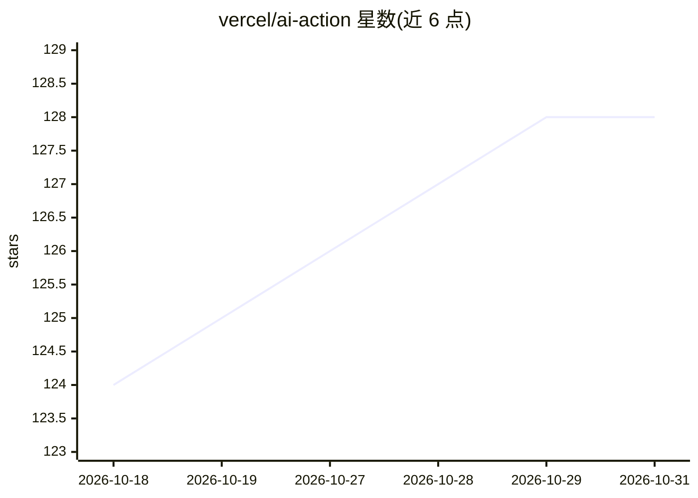

# vercel/ai-action

⭐ 128 · JavaScript · ISC · 推送 2026-10-06 · [GitHub](https://github.com/vercel/ai-action) · 组织维护

**在 GitHub Actions 工作流中调用 AI 模型的 Action**

Vercel 维护的 GitHub Action，通过 AI SDK 向 AI Gateway 发送请求：输入 prompt、api-key 与模型标识即可在 CI 工作流中生成文本；提供 JSON Schema 时调用 generateObject 生成符合 schema 的结构化 JSON；可选 system 消息设定模型行为。README 用大量篇幅警示用户输入（issue 标题/正文/标签）的提示注入风险，要求用环境变量做净化。示例用途包括 issue 分诊、版本号计算与发布说明、README 变更垃圾检测。

## 筛选速览

| 维度 | 判定 | 备注 |
|---|---|---|
| AI 角色 | `ai-ecosystem` | LLM/agent 周边工具 |
| 许可风险 | `permissive` | ISC |
| 部署形态 | `None` |  |
| 模型依赖 | — | README 未给出锁定关系 |
| 硬件要求 | — | 无带数字的原话,不猜 |
| 安装摩擦 | `low` | 无编译、无系统依赖或容器化 |
| 成熟度 | — | 结构信号不足 |

## 能力要点

- generateText 文本生成与 generateObject 结构化 JSON 生成
- 通过 Vercel AI Gateway 接入多家模型提供商
- 可选 system 消息设定模型行为上下文
- README 详细说明提示注入风险与净化方法

## 适用场景

- 在 CI 中对 issue 自动分类、打标签或检测垃圾内容
- 自动生成版本号提升与发布说明
- 在工作流中产出符合 JSON Schema 的结构化数据

## 场景标签

 · 领域:开发者工具/CI 自动化

## 证据(README 行号)

> L5: GitHub Action to interact with different AI model providers.
> L130: The action is utilizing the AI SDK to send requests to the AI Gateway.

## 星数曲线

2026-10-18 124 → 2026-10-31 128（+4）

---
*卡片 v1 · prompt 1.4 · 生成 2026-10-23 · 置信度 high · 依据 README sha `b68a6cbbda96` · [字段定义](../../DATASET.md)*
