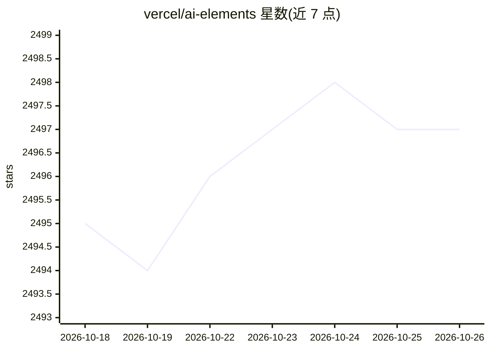

# vercel/ai-elements

⭐ 2,497 · TypeScript · NOASSERTION · 推送 2026-10-14 · [GitHub](https://github.com/vercel/ai-elements) · [官网](https://elements.ai-sdk.dev) · 组织维护

**面向 AI 应用的 React 组件库与注册表，基于 shadcn/ui**

Vercel 维护的组件库：提供对话、消息、代码块、推理展示等面向 AI 应用的可定制 React 组件，通过 npx CLI 或 shadcn CLI 将组件安装到项目的 components 目录，安装后组件进入用户代码库可完全自定义。要求 Node.js 18+、Next.js 项目、已安装 AI SDK 并初始化 shadcn/ui（仅支持 CSS Variables 模式）。README 声明本项目将于 2026 年 11 月底弃用，由 shadcn/ui 版本的 AI Elements 取代。

## 筛选速览

| 维度 | 判定 | 备注 |
|---|---|---|
| AI 角色 | `ai-ecosystem` | LLM/agent 周边工具 |
| 许可风险 | `none` | NOASSERTION |
| 部署形态 | `library` | 以包/库形式分发 |
| 模型依赖 | — | README 未给出锁定关系 |
| 硬件要求 | — | 无带数字的原话,不猜 |
| 安装摩擦 | `low` | 无编译、无系统依赖或容器化 |
| 成熟度 | — | 结构信号不足 |

## 能力要点

- 提供对话/消息/代码块/推理展示等 AI 场景 React 组件
- CLI 自动检测包管理器（npm/pnpm/yarn/bun）并经 shadcn CLI 安装组件
- 组件安装进代码库，支持完全自定义
- 兼容 shadcn/ui 标准注册表机制

## 适用场景

- 为 Next.js + AI SDK 项目快速搭建聊天界面
- 在已有 shadcn/ui 项目中按需添加 AI 对话组件
- 基于组件源码自定义 AI 应用的交互样式

## 场景标签

 · 领域:AI 应用前端/组件库

## 证据(README 行号)

> L6: AI Elements is a component library built on top of shadcn/ui to help you build AI-native applications faster.
> L10: AI Elements provides pre-built, customizable React components specifically designed for AI applications, including 

## 星数曲线

2026-10-18 2,495 → 2026-10-26 2,497（+2）

---
*卡片 v1 · prompt 1.4 · 生成 2026-10-21 · 置信度 high · 依据 README sha `eeb2210925bb` · [字段定义](../../DATASET.md)*
