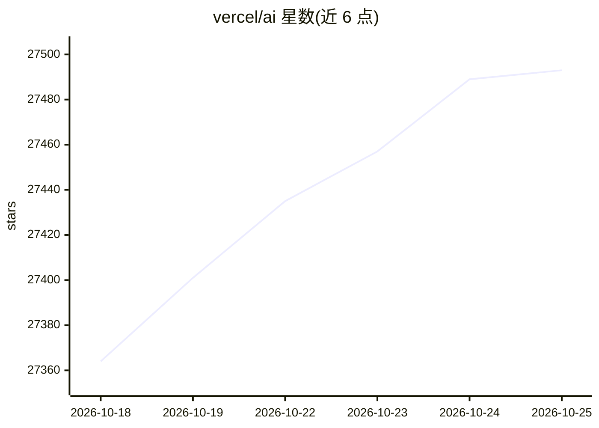

# vercel/ai

⭐ 27,510 · TypeScript · NOASSERTION · 推送 2026-10-25 · [GitHub](https://github.com/vercel/ai) · [官网](https://ai-sdk.dev) · 组织维护

**给 TypeScript 开发者的统一接口 AI 应用与 Agent 构建工具包**

Vercel 出品的 provider-agnostic TypeScript 工具库，用于构建 AI 应用与 Agent。核心机制：统一 Provider API 接入 OpenAI、Anthropic、Google 等模型提供方，默认经 Vercel AI Gateway 访问各提供方，也可安装各家的 @ai-sdk/* 包直连。提供 generateText 文本生成、基于 zod 的结构化输出、ToolLoopAgent 工具循环 Agent，以及框架无关的 UI hooks（Next.js/React/Svelte/Vue）用于构建聊天与生成式界面。要求 Node.js 22+，通过 npm 安装，并为 Claude Code、Cursor 等 coding agent 提供 skill 安装命令。

## 筛选速览

| 维度 | 判定 | 备注 |
|---|---|---|
| AI 角色 | `ai-ecosystem` | LLM/agent 周边工具 |
| 许可风险 | `none` | NOASSERTION |
| 部署形态 | `library` | 以包/库形式分发 |
| 模型依赖 | locked-api |  |
| 硬件要求 | — | 无带数字的原话,不猜 |
| 安装摩擦 | `low` | 无编译、无系统依赖或容器化 |
| 成熟度 | — | 结构信号不足 |

## 动量与使用信号

- 维护:`active` — 距上次 push 1.3 天,年发版 100,469 位贡献者
- 涨星:近 1 天 **+21**(自 20261016 起算)
- 安装:npm 包 `ai` 月下载 121,188,982

## 能力要点

- 统一 Provider API 接入 OpenAI、Anthropic、Google 等模型提供方
- 默认经 Vercel AI Gateway 访问各主要提供方，传模型字符串即可调用
- ToolLoopAgent 构建工具循环 Agent，zod 定义结构化输出
- 框架无关 UI hooks 支持 Next.js/React/Svelte/Vue 的聊天与生成式界面

## 适用场景

- 在 Next.js/React 等前端框架里构建聊天机器人与生成式 UI
- 用统一接口在多个模型提供方之间切换调用
- 构建带工具调用的 Agent 应用

## 场景标签

`Agent 框架` `模型网关` · 领域:Agent 开发

## 证据(README 行号)

> L5: The AI SDK is a provider-agnostic TypeScript toolkit designed to help you build AI-powered applications and agents u
> L27: The AI SDK provides a unified API to interact with model providers like OpenAI, Anthropic, Google, and more.
> L29: By default, the AI SDK uses the Vercel AI Gateway to give you access to all major providers out of the box. Just pa

## 星数曲线

2026-10-18 27,364 → 2026-10-25 27,493（+129）

---
*卡片 v1 · prompt 1.4 · 生成 2026-10-18 · 置信度 high · 依据 README sha `37452bf5f630` · [字段定义](../../DATASET.md)*
