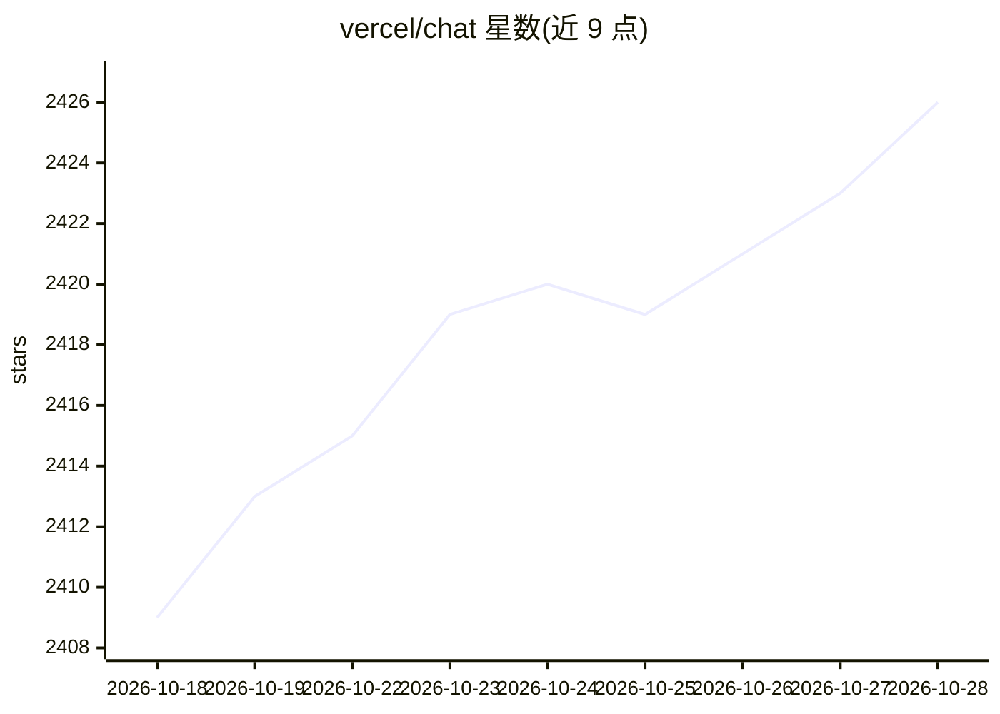

# vercel/chat

⭐ 2,427 · TypeScript · MIT · 推送 2026-10-28 · [GitHub](https://github.com/vercel/chat) · [官网](https://chat-sdk.dev/) · 组织维护

**统一 TypeScript SDK：一套代码构建多平台聊天机器人与 agent**

Vercel 维护的 MIT 许可 TypeScript SDK，将 Slack、Teams、Google Chat、Discord、Telegram、GitHub、Linear、WhatsApp 等平台的消息接口抽象为统一层，开发者编写一次 bot 逻辑即可部署到多个平台。机制上通过各平台适配器包接入，提供事件处理（提及、反应、斜杠命令、模态框）、AI 流式输出、JSX 交互卡片、文件上传等能力；配套 create-chat-sdk CLI 脚手架与 @chat-adapter/catalog 适配器目录。限制：具体能力依赖各适配器支持情况。

## 筛选速览

| 维度 | 判定 | 备注 |
|---|---|---|
| AI 角色 | `ai-ecosystem` | LLM/agent 周边工具 |
| 许可风险 | `permissive` | MIT |
| 部署形态 | `library` | 以包/库形式分发 |
| 模型依赖 | — | README 未给出锁定关系 |
| 硬件要求 | — | 无带数字的原话,不猜 |
| 安装摩擦 | `low` | 无编译、无系统依赖或容器化 |
| 成熟度 | — | 结构信号不足 |

## 能力要点

- 一套 bot 逻辑部署到 Slack/Teams/Discord/Telegram/WhatsApp 等多平台
- LLM 响应流式输出（Slack 原生流、Telegram 草稿预览、post+edit 回退）
- JSX 编写跨平台交互卡片（Block Kit/Adaptive Cards 等）
- create-chat-sdk CLI 生成 Next.js bot 应用脚手架

## 适用场景

- 我需要在多个聊天平台同时上线同一个 bot
- 我要构建带 LLM 流式回复的对话 agent
- 我想要统一 API 处理各平台的命令、卡片与模态交互

## 场景标签

`Agent 框架` · 领域:Agent 开发

## 证据(README 行号)

> L6: Unified TypeScript SDK for building chat bots across Slack, Microsoft Teams, Google Chat, Discord, Telegram, GitHub,
> L65: - **AI streaming** — stream LLM responses with native Slack streaming, Telegram private chat draft previews, and po

## 星数曲线

2026-10-18 2,409 → 2026-10-28 2,426（+17）

---
*卡片 v1 · prompt 1.4 · 生成 2026-10-21 · 置信度 high · 依据 README sha `7a2192d173da` · [字段定义](../../DATASET.md)*
