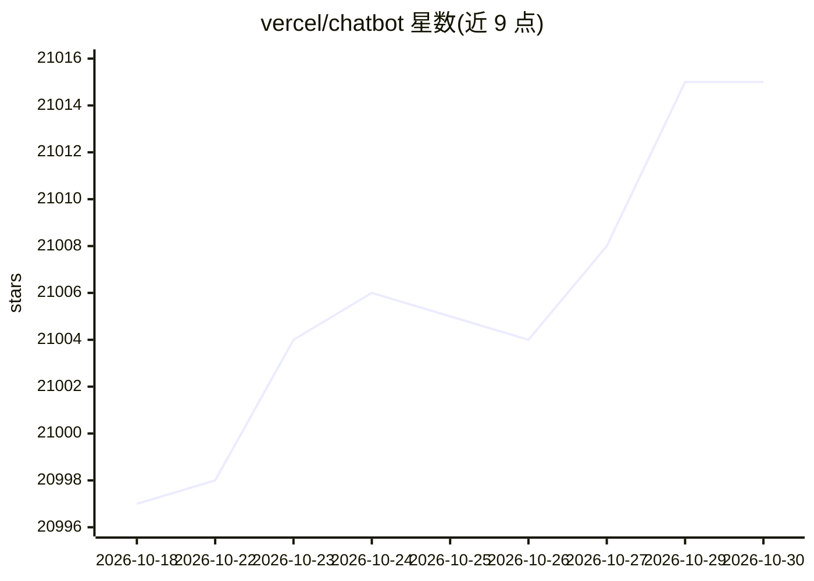

# vercel/chatbot

⭐ 21,015 · TypeScript · NOASSERTION · 推送 2026-07-08 · [GitHub](https://github.com/vercel/chatbot) · [官网](https://chatbot.ai-sdk.dev) · 组织维护

**面向开发者的 Next.js 开源 AI 聊天机器人模板**

由 Vercel 构建的 Next.js + AI SDK 聊天机器人模板，覆盖对话界面、聊天历史与用户数据的 Postgres 持久化、文件存储、Auth.js 认证等模块。模型访问通过 Vercel AI Gateway 统一接口完成，在 lib/ai/models.ts 中按模型配置 provider 路由，内置 Mistral、Moonshot、DeepSeek、OpenAI、xAI 等模型；非 Vercel 部署需自行设置 AI_GATEWAY_API_KEY。可一键部署到 Vercel，本地运行依赖 .env 环境变量与数据库迁移。

## 筛选速览

| 维度 | 判定 | 备注 |
|---|---|---|
| AI 角色 | `ai-ecosystem` | LLM/agent 周边工具 |
| 许可风险 | `none` | NOASSERTION |
| 部署形态 | `library` | 以包/库形式分发 |
| 模型依赖 | locked-api |  |
| 硬件要求 | — | 无带数字的原话,不猜 |
| 安装摩擦 | `low` | 无编译、无系统依赖或容器化 |
| 成熟度 | — | 结构信号不足 |

## 动量与使用信号

- 维护:`maintenance` — 距上次 push 101.4 天,年发版 0,75 位贡献者
- 涨星:近 1 天 **+2**(自 20261016 起算)
- 安装:npm 包 `vercel` 月下载 19,202,235

## 能力要点

- 基于 Next.js App Router、RSC 与 Server Actions 构建
- 通过 Vercel AI Gateway 统一接入多家模型提供商
- Neon Serverless Postgres 保存聊天历史，Vercel Blob 存储文件
- Auth.js 认证与 shadcn/ui + Tailwind 界面组件

## 适用场景

- 作为起点快速搭建自己的聊天机器人应用
- 部署到 Vercel 运行一个可用的 AI 对话站点
- 需要多模型切换与工具调用的 LLM 应用开发

## 场景标签

`聊天机器人` · 领域:对话与助手

## 证据(README 行号)

> L6:  Chatbot (formerly AI Chatbot) is a free, open-source template built with Next.js and the AI SDK that helps you quic
> L34: This template uses the Vercel AI Gateway to access multiple AI models through a unified interface. Models are confi

## 星数曲线

2026-10-18 20,997 → 2026-10-30 21,015（+18）

---
*卡片 v1 · prompt 1.4 · 生成 2026-10-18 · 置信度 high · 依据 README sha `d975405c5848` · [字段定义](../../DATASET.md)*
