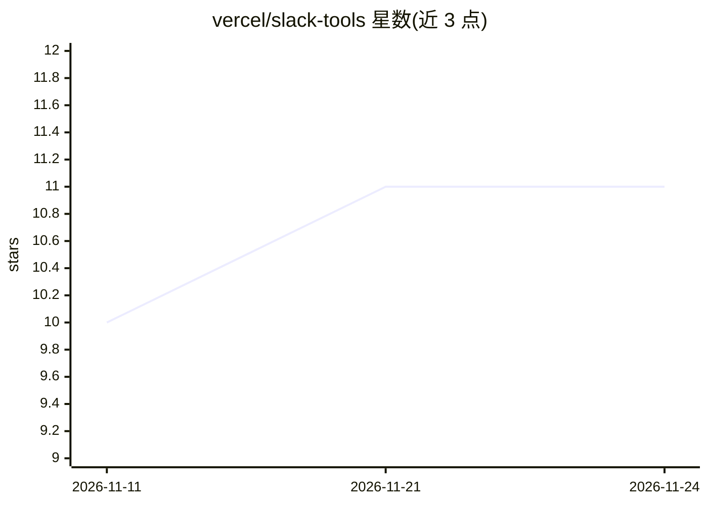

# vercel/slack-tools

⭐ 11 · TypeScript · MIT · 推送 2026-04-24 · [GitHub](https://github.com/vercel/slack-tools) · [官网](https://www.npmjs.com/package/slack-tools) · 组织维护

**为 Vercel AI SDK 提供 Slack 读写工具的库**

面向使用 Vercel AI SDK 构建 agent 的 JavaScript 开发者，提供一组类型化的 Slack 工具调用：发送/定时消息、创建 Canvas、搜索消息/频道/用户、读取频道与线程、加入频道、删除消息等 12 个工具，每个工具含 inputSchema、outputSchema、execute 与 toModelOutput。无需 MCP 传输，直接传入 generateText/streamText 或 AI SDK agent；支持 needsApproval 人工审批配置。需 Slack 用户 OAuth token 及一组 scopes。

## 筛选速览

| 维度 | 判定 | 备注 |
|---|---|---|
| AI 角色 | `ai-ecosystem` | LLM/agent 周边工具 |
| 许可风险 | `permissive` | MIT |
| 部署形态 | `library` | 以包/库形式分发 |
| 模型依赖 | — | README 未给出锁定关系 |
| 硬件要求 | — | 无带数字的原话,不猜 |
| 安装摩擦 | `low` | 无编译、无系统依赖或容器化 |
| 成熟度 | — | 结构信号不足 |

## 能力要点

- 12 个类型化 Slack 工具，含 schema 与 execute
- needsApproval 可按工具配置执行前人工审批
- 返回类型化对象并提供 toModelOutput 文本格式化
- 无需 MCP 传输层

## 适用场景

- 让 AI agent 在 Slack 中读取频道历史并回复消息
- 为 agent 添加搜索 Slack 公开/私有消息的能力
- 对敏感操作（如删除消息）要求人工审批

## 场景标签

`Agent 框架` · 领域:Agent 开发

## 证据(README 行号)

> L6: AI SDK tools for Slack. Typed, structured tool calls for AI agents. No MCP transport required.
> L32: Returns all available Slack tools, ready to pass to `generateText`, `streamText`, or any AI SDK agent.

## 星数曲线

2026-11-11 10 → 2026-11-24 11（+1）

---
*卡片 v1 · prompt 1.4 · 生成 2026-11-19 · 置信度 high · 依据 README sha `5297537ba503` · [字段定义](../../DATASET.md)*
