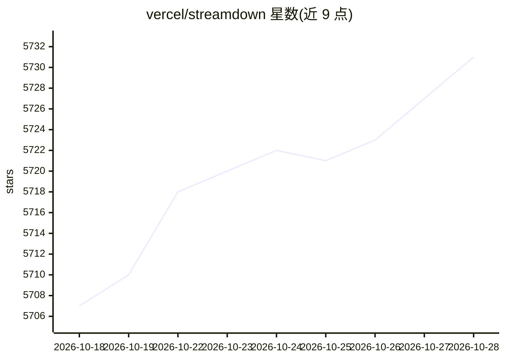

# vercel/streamdown

⭐ 5,731 · TypeScript · NOASSERTION · 推送 2026-10-27 · [GitHub](https://github.com/vercel/streamdown) · [官网](https://streamdown.ai) · 组织维护

**面向 AI 流式输出的 react-markdown 替代 React 组件**

npm 包形式的 React Markdown 渲染组件，定位为 react-markdown 的 drop-in replacement，针对 AI 模型流式输出场景处理不完整或未闭合的 Markdown 语法（基于 remend 构建）。支持 GitHub Flavored Markdown、KaTeX 数学公式、Mermaid 图表、Shiki 代码高亮，并通过 rehype-harden 提供安全渲染。它为 AI Elements 的 Message 组件提供底层渲染，也可独立安装使用。安装需配合 Tailwind CSS（@source 指令）与 shadcn/ui 设计令牌，Monorepo 需调整相对路径。

## 筛选速览

| 维度 | 判定 | 备注 |
|---|---|---|
| AI 角色 | `ai-ecosystem` | LLM/agent 周边工具 |
| 许可风险 | `none` | NOASSERTION |
| 部署形态 | `library` | 以包/库形式分发 |
| 模型依赖 | — | README 未给出锁定关系 |
| 硬件要求 | — | 无带数字的原话,不猜 |
| 安装摩擦 | `low` | 无编译、无系统依赖或容器化 |
| 成熟度 | — | 结构信号不足 |

## 能力要点

- react-markdown 的 drop-in replacement，可替换使用
- 流式优化：处理不完整/未终止的 Markdown 语法块
- 内置 GFM、KaTeX 数学、Mermaid 图表、Shiki 代码高亮渲染
- 基于 rehype-harden 的安全渲染与 memoized 性能优化

## 适用场景

- 在聊天应用中渲染 LLM 流式输出的 Markdown 文本
- 替换 react-markdown 以支持流式增量渲染
- 渲染带表格、公式、图表的 AI 回复内容

## 场景标签

 · 领域:前端/AI 界面组件

## 证据(README 行号)

> L3: A drop-in replacement for react-markdown, designed for AI-powered streaming.
> L9: Formatting Markdown is easy, but when you tokenize and stream it, new challenges arise. Streamdown is built specific
> L11: Streamdown powers the AI Elements Message component but can be installed as a standalone package for your own strea

## 星数曲线

2026-10-18 5,707 → 2026-10-28 5,731（+24）

---
*卡片 v1 · prompt 1.4 · 生成 2026-10-20 · 置信度 high · 依据 README sha `5fbf217c204d` · [字段定义](../../DATASET.md)*
