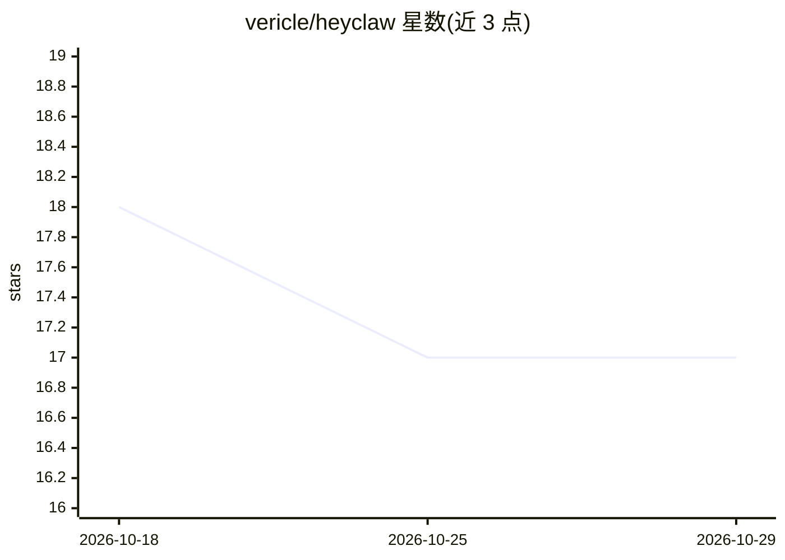

# vericle/heyclaw

⭐ 17 · Python · MIT · 推送 2026-08-10 · [GitHub](https://github.com/vericle/heyclaw) · 个人维护

**自托管的语音优先个人 AI 助手，本地唤醒词加实时对话**

由后端与卫星端两个 Python 包组成：卫星端负责本地麦克风采集、openWakeWord 唤醒词检测与回声处理；后端通过 ElevenLabs Speech Engine 做实时语音转文字与语音合成，LLM 可配置为 Gemini（默认）、OpenAI 或 Anthropic（经 DSPy ReAct agent），Mem0 提供用户级长期记忆，MCP 工具与工作区技能提供外部能力。运行需 Python 3.12、uv、GNU Make、ngrok 与麦克风/扬声器，Linux/WSL 与原生 Windows 分别用不同 Makefile。

## 筛选速览

| 维度 | 判定 | 备注 |
|---|---|---|
| AI 角色 | `ai-native` | 本体是模型或模型工具 |
| 许可风险 | `permissive` | MIT |
| 部署形态 | `desktop` | 安装包/桌面程序 |
| 模型依赖 | locked-api |  |
| 硬件要求 | — | 无带数字的原话,不猜 |
| 安装摩擦 | `low` | 无编译、无系统依赖或容器化 |
| 成熟度 | — | 结构信号不足 |

## 能力要点

- 本地 openWakeWord 唤醒词检测与卫星端/后端分离架构
- 实时 STT/TTS 由 ElevenLabs Speech Engine 承担，LLM 可选 Gemini/OpenAI/Anthropic
- Mem0 用户级持久语义记忆，MCP 工具动态发现
- Make 目标覆盖 setup/backend/satellite 等流程，含 Ruff 与 mypy 检查

## 适用场景

- 自建一台语音唤醒的房间 AI 助手
- 带长期记忆的私人语音对话助手
- 在本地工作区自定义 agent 指令与技能并通过 MCP 接外部工具

## 场景标签

 · 领域:语音 AI 助手/个人 agent

## 证据(README 行号)

> L5: **A lightweight, open-source, voice-first personal AI agent.**
> L23: - real-time speech-to-text and text-to-speech through ElevenLabs Speech Engine;
> L24: - configurable Gemini, OpenAI, or Anthropic language models through DSPy;

## 星数曲线

2026-10-18 18 → 2026-10-29 17（-1）

---
*卡片 v1 · prompt 1.4 · 生成 2026-10-29 · 置信度 high · 依据 README sha `111f84cdb6db` · [字段定义](../../DATASET.md)*
