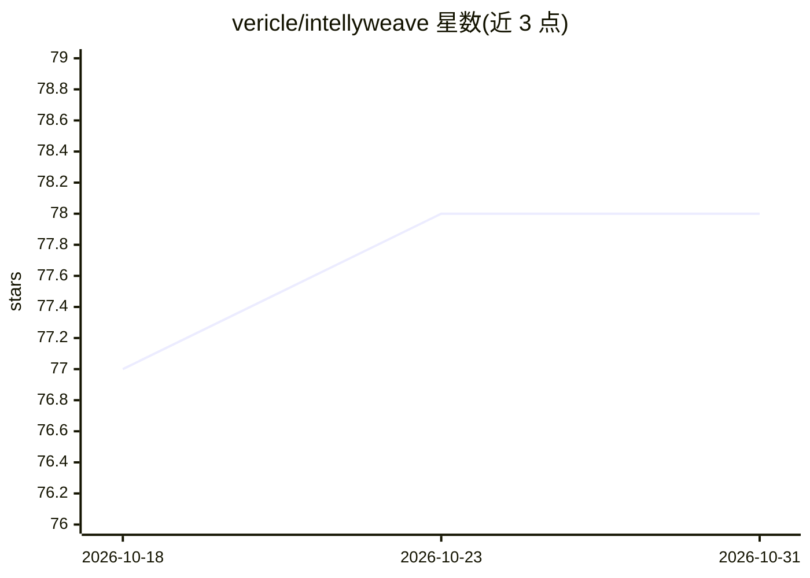

# vericle/intellyweave

⭐ 78 · Python · BSD-3-Clause · 推送 2026-09-02 · [GitHub](https://github.com/vericle/intellyweave) · 组织维护

**面向情报分析员的 OSINT 分析平台：实体抽取、地图与档案调查**

开源情报（OSINT）分析平台：上传多格式文档（PDF/DOCX/TXT/Markdown）后，自动用 GLiNER 零样本抽取 7 类实体，在 Mapbox 3D 地图与 vis-network 关系图上可视化；提供 Quartermaster+Case Officer 双 agent 档案调查（30+ 档案源、假设检验与置信度评分）和 6 阶段情报编排流水线，并以多 agent 辩论回答自然语言问题且附引用来源。多 LLM 提供商支持（OpenAI/Anthropic/Google/Ollama）。技术栈为 FastAPI+Next.js+Weaviate+DSPy，配独立 CLI 与在线演示。限制：不做实时监控、不含无人工审查的自动决策。

## 筛选速览

| 维度 | 判定 | 备注 |
|---|---|---|
| AI 角色 | `ai-native` | 本体是模型或模型工具 |
| 许可风险 | `permissive` | BSD-3-Clause |
| 部署形态 | `self-host` | docker 或自建部署 |
| 模型依赖 | local-ok | 支持本地模型 |
| 硬件要求 | — | 无带数字的原话,不猜 |
| 安装摩擦 | `low` | 无编译、无系统依赖或容器化 |
| 成熟度 | — | 结构信号不足 |

## 能力要点

- GLiNER 零样本实体抽取，支持 7 类实体（人物/组织/地点/日期/事件/法律/代号）
- Quartermaster+Case Officer 双 agent 档案调查，假设生成带置信度与证据引用
- 6 阶段情报编排流水线：抽取→关系映射→地理→网络→模式→综合
- 多 LLM 提供商支持：OpenAI、Anthropic、Google、Ollama 本地模型

## 适用场景

- 情报分析员从多份文档中抽取实体并发现隐藏关联
- 历史研究者探索解密档案，进行假设驱动的调查
- 调查人员跨文档追踪实体并在地图上还原路线与网络

## 场景标签

`多智能体` `知识图谱` `RAG` · 领域:Agent 开发

## 证据(README 行号)

> L16: IntellyWeave is an **Open-Source Intelligence (OSINT) analysis platform** that automatically extracts entities from
> L148: Multi-provider support including OpenAI, Anthropic Claude, Google Gemini, and local models via Ollama. Configurabl

## 星数曲线

2026-10-18 77 → 2026-10-31 78（+1）

---
*卡片 v1 · prompt 1.4 · 生成 2026-10-24 · 置信度 mid · 依据 README sha `f28664417dcb` · [字段定义](../../DATASET.md)*
