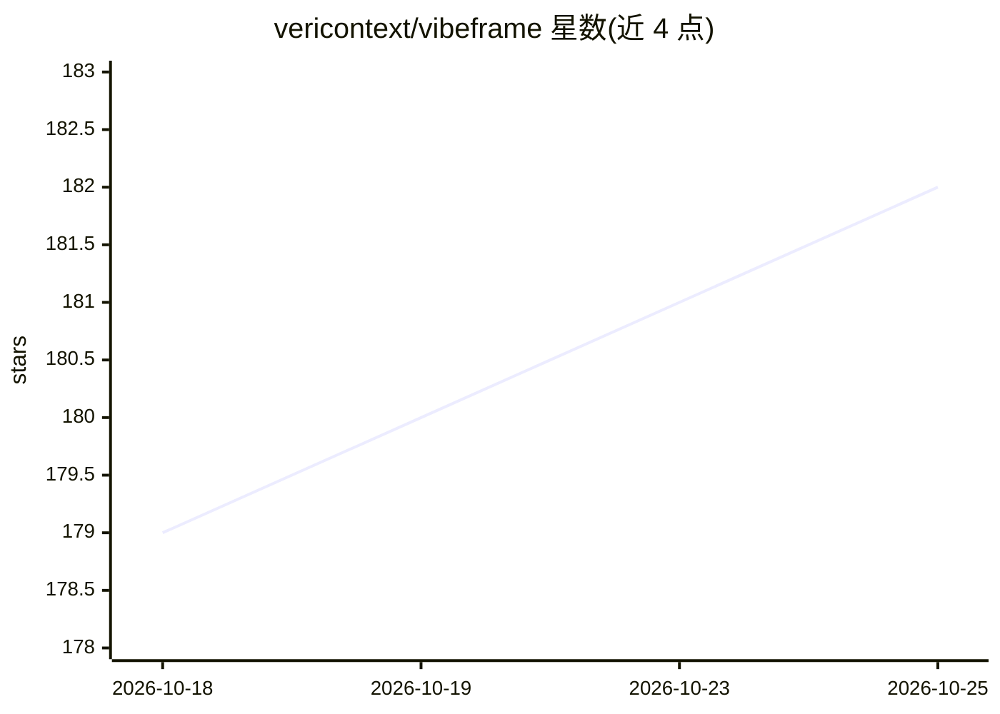

# vericontext/vibeframe

⭐ 182 · TypeScript · MIT · 推送 2026-10-24 · [GitHub](https://github.com/vericontext/vibeframe) · [官网](https://vibeframe.ai) · 组织维护

**让编码 Agent 用自有 API key 生成视频的 CLI 与 MCP 工具**

面向 Claude Code、Codex、Cursor 等 bash 型 agent 的 CLI 与 MCP server：把文字 brief 转成 storyboard 计划，调用 Seedance、Runway、Kling、Gemini、OpenAI 等模型生成关键帧与视频素材，再经无头 Chrome 与 FFmpeg 本地渲染 MP4。所有付费步骤前置 --dry-run 估价与 --max-cost 硬上限，失败以机器可读的恢复动作返回；角色池机制用于跨场景保持角色一致。无 key 时本地管线（HTML 场景、Kokoro 配音、渲染）可零成本运行。需 Node.js 20+、FFmpeg、Chrome。

## 筛选速览

| 维度 | 判定 | 备注 |
|---|---|---|
| AI 角色 | `ai-native` | 本体是模型或模型工具 |
| 许可风险 | `permissive` | MIT |
| 部署形态 | `library` | 以包/库形式分发 |
| 模型依赖 | — | README 未给出锁定关系 |
| 硬件要求 | — | 无带数字的原话,不猜 |
| 安装摩擦 | `medium` | 含编译或系统依赖之一 |
| 成熟度 | — | 结构信号不足 |

## 能力要点

- --dry-run 全链路估价与 --max-cost 硬性花费上限
- 角色池 + Seedance 图生视频保持跨场景角色一致
- 失败返回 retryWith/nextActions 等机器可读恢复动作
- 免费本地管线（Kokoro 配音、FFmpeg 渲染）无需 provider key

## 适用场景

- 让编码 agent 从一段 brief 端到端产出短视频
- 在明确花费上限下调用前沿图像/视频模型生成素材
- 用 review-report 驱动 agent 循环修复渲染质量问题

## 场景标签

`视频生成` · 领域:内容生成

## 证据(README 行号)

> L3: **Let your coding agent generate real video, on your own provider keys, under a spend ceiling it cannot cross.**
> L6: It turns a written brief into a plan, generates the assets from frontier models (Seedance, Runway, Kling, Gemini Omn

## 星数曲线

2026-10-18 179 → 2026-10-25 182（+3）

---
*卡片 v1 · prompt 1.4 · 生成 2026-10-22 · 置信度 mid · 依据 README sha `fcdbf8be5e3a` · [字段定义](../../DATASET.md)*
